# 拾页笔记（GleanNote）服务端架构文档

## 0. 文档信息

| 项目 | 内容 |
|---|---|
| 文档名称 | 拾页笔记服务端架构文档 |
| 文档编号 | GN-ARCH-001 |
| 版本 | v1.0 |
| 状态 | 已评审基线（Draft → Baseline） |
| 更新日期 | 2026-11-01 |
| 适用代码库 | `a:\dev_pjs\GleanNote`（仅服务端，不含 Android 客户端与 Web 前端） |
| 需求基线 | [PRD-拾页笔记-GleanNote.md](PRD-拾页笔记-GleanNote.md) v1.2 |
| 配套文档 | [API.md](API.md) 接口文档、[openapi.yaml](openapi.yaml) 机器可读契约、[CONVENTIONS.md](CONVENTIONS.md) 工程规范 |
| 目标读者 | 服务端研发、测试、运维、架构评审人 |

### 0.1 文档职责边界

本文只回答三个问题：**系统由哪些部分构成**、**为什么这样构成**、**每个部分必须遵守什么约束**。
本文不定义接口字段级的请求与响应（见 [API.md](API.md)），不定义编码与注释细节（见 [CONVENTIONS.md](CONVENTIONS.md)），不重复产品行为规则（见 PRD 第 4、5 章）。

### 0.2 修订记录

| 版本 | 日期 | 修订人 | 说明 |
|---|---|---|---|
| v0.1 | 2026-10-28 | 服务端架构组 | 首版：上下文、构建块、运行时、部署、横切概念、ADR |
| v1.0 | 2026-11-01 | 服务端架构组 | 交付口径对齐：队列为 Redis 列表 + `BLMOVE` 可靠队列；公开分享页 `GET /s/{token}` 纯文本渲染；新增 `NOTE_MODIFIED`/`INTERNAL_ERROR` 失败码；`ReleaseRunning` 单实例约束与阶段四租约提示 |

### 0.3 编制依据（规范与出处）

以下标准与规范构成本文档的约束来源。凡本文出现「必须 / 应当 / 可以」的措辞，按 RFC 2119 的语义理解。

| 编号 | 规范 | 出处 | 在本文中的落地位置 |
|---|---|---|---|
| S1 | HTTP 语义与状态码 | RFC 9110《HTTP Semantics》，<https://www.rfc-editor.org/rfc/rfc9110.html> | 8.2 错误模型、8.4 幂等 |
| S2 | HTTP API 问题详情 | RFC 9457《Problem Details for HTTP APIs》，<https://www.rfc-editor.org/rfc/rfc9457.html> | 8.2 错误模型 |
| S3 | 资源导向 API 设计 | Google AIP 系列，<https://google.aip.dev/> | 8.1、8.3、8.4、8.9 |
| S4 | 分页 | Google AIP-158，<https://google.aip.dev/158> | 8.3 分页 |
| S5 | 过滤 | Google AIP-160，<https://google.aip.dev/160> | 8.3 过滤与排序 |
| S6 | 软删除与恢复 | Google AIP-164，<https://google.aip.dev/164> | 8.10 软删除 |
| S7 | 自定义方法 | Google AIP-136，<https://google.aip.dev/136> | 8.3 路径风格 |
| S8 | 错误码与错误详情 | Google AIP-193，<https://google.aip.dev/193> | 8.2 错误模型 |
| S9 | 版本与兼容 | Google AIP-180 / AIP-185，<https://google.aip.dev/180> | 8.15 版本与兼容 |
| S10 | 云端 API 通用指南 | Microsoft REST API Guidelines，<https://github.com/microsoft/api-guidelines> | 8.3、8.4、8.13 |
| S11 | 架构文档模板 | arc42，<https://arc42.org/overview/> | 全文结构 |
| S12 | 架构图模型 | C4 model，<https://c4model.com/> | 3、5、7 章 |
| S13 | Go 注释与文档 | Go Doc Comments，<https://go.dev/doc/comment>；Go Code Review Comments，<https://go.dev/wiki/CodeReviewComments> | 8.14、CONVENTIONS.md |
| S14 | Go 模块布局 | Organizing a Go module，<https://go.dev/doc/modules/layout> | 5.2 代码结构 |
| S15 | 密码存储 | OWASP Password Storage Cheat Sheet，<https://cheatsheetseries.owasp.org/cheatsheets/Password_Storage_Cheat_Sheet.html> | 8.6 认证 |
| S16 | 中文时间与时区 | IANA 时区数据库 `Asia/Shanghai` | 8.5 时间口径 |

参考的开源同类项目（仅作设计对照，不引入其代码）：

| 项目 | 参考点 | 结论 |
|---|---|---|
| [usememos/memos](https://github.com/usememos/memos) | Go 单体 + 多存储驱动 + 资源型 API；`server/`、`store/` 分层 | 采用「单体服务 + 存储接口抽象」，但 API 风格改为 AIP 风格 |
| [go-notes（自托管协作笔记）](https://pkg.go.dev/github.com/rd2w/go-notes) | 目录/标签/全文检索的最小闭环 | 采用其「目录树 + 标签双维度」组织方式，冲突处理改为服务端权威 |
| [Go 全栈笔记应用（六边形架构 + DDD）](https://sazardev.netlify.app/blog/en/go-fullstack-notes-app-solidjs-auth-hexagonal-ddd/) | 六边形分层与端口/适配器命名 | 采用其端口与适配器分层，收敛为 4 层 |

## 1. 引言与目标

### 1.1 业务目标

服务端是「纸质页面 → 可编辑 Markdown 笔记」这条链路的**唯一权威数据源**。它必须同时满足三件事：

1. 承载 PRD 第 2.1 节的 P0 闭环，包括登录、目录、图片上传、AI 转换、编辑保存、回收站、多设备同步；
2. 在单台 2C4G 云主机上稳定运行，不依赖额外中间件集群；
3. 为 P1 功能（搜索、标签、导出、分享、版本、批量导入、追加页面）预留扩展位，且扩展时不破坏既有契约。

### 1.2 质量目标（arc42 §1.2）

质量目标按优先级排序，每条都给出可验证口径，避免「快、稳、安全」这类无法验收的表述。

| 优先级 | 质量属性 | 场景化目标 | 验证方式 |
|---|---|---|---|
| 1 | 数据正确性 | 任何写入路径不得产生跨账号可见数据；冲突写入不得静默丢失内容 | 越权用例集 + 冲突用例集，CI 每次执行 |
| 2 | 可靠性 | 服务端为同步唯一权威；单实例重启后不丢已应答写入 | 提交后强制重启的集成测试 |
| 3 | 性能 | 纯读写接口 p95 ≤ 300ms；含事务写入 p95 ≤ 500ms；同步增量接口 p95 ≤ 800ms；单机稳定承载 100 RPS | 压测报告（k6，30 分钟） |
| 4 | 可恢复性 | RPO ≤ 24h（数据库每日全量 + 每小时增量）；RTO ≤ 2h（单机重装重建） | 每季度恢复演练 |
| 5 | 可维护性 | 新增一个业务用例不修改超过 3 个包；单测覆盖应用层用例 | 代码评审检查项 |
| 6 | 安全性 | 满足 OWASP ASVS 4.0 L1 的核心条目：口令加盐哈希、传输加密、越权防护、注入防护、上传校验 | 安全扫描 + 渗透用例 |
| 7 | 可观测性 | 任一 5xx 可在 5 分钟内由日志与指标定位到请求、用户、任务 | 故障演练 |

### 1.3 约束（arc42 §1.3）

| 类型 | 约束 | 来源 |
|---|---|---|
| 技术 | 服务端语言 Go 1.25；HTTP 框架 Gin | PRD 0 节「已确认技术背景」 |
| 技术 | 部署环境阿里云 ECS 2C4G，Rocky Linux 9 | 同上 |
| 技术 | AI 识图由外部多模态接口完成，本期只定义适配器，不绑定供应商 | 本轮决策 |
| 组织 | 只有服务端仓库，不包含客户端实现 | 本轮任务范围 |
| 产品 | 单账号单角色（笔记所有者），无协作与共享编辑 | PRD 3.1 |
| 产品 | 全量用户同一额度与存储上限，无付费体系 | PRD 2.4 |
| 合规 | 全部时间口径为北京时间；未登录不得访问任何笔记数据 | PRD 5.8、5.7 |

### 1.4 明确的技术非目标

- 不做微服务拆分、不做服务网格、不引入 Kubernetes（单机 2C4G 下收益低于复杂度）。
- 不做多租户 SaaS 隔离（一个部署实例对应一套自有用户数据）。
- 不做服务端渲染的富文本编辑器；正文以 Markdown 纯文本存储，渲染由客户端负责，分享页只做纯文本转义展示。
- 不做离线 OCR、不做图片内容审核之外的额外 AI 能力（PRD 2.4）。

## 2. 术语

产品术语沿用 PRD 0.1 节，此处只补充服务端语境下的技术术语。

| 术语 | 定义 |
|---|---|
| 资源 | REST 语义下的可寻址实体，本系统包括用户、目录、笔记、页面图片、转换任务、标签、版本、分享链接 |
| 修订号 revision | 笔记正文的单调递增整数，用于乐观锁与冲突检测 |
| 变更游标 cursor | 增量同步的位置标记，对应变更日志的自增序号 |
| 变更日志 | 按用户记录的写入事件序列，是增量同步的唯一来源 |
| 上传会话 | 一次图片直传的短期凭证与状态记录，生命周期 30 分钟 |
| 转换任务 | 可靠队列中执行的一次「图片 → Markdown」作业，与笔记一对一且只保留最近一次 |
| 配额账本 | 按「用户 + 北京日期」记录的额度扣减与返还流水 |
| 软删除 | 仅置删除标记与到期时间的删除方式，数据保留 30 天 |
| 冲突副本 | 并发写入时被覆盖内容的保全副本，作为独立笔记存在 |

## 3. 系统上下文（C4 Level 1）

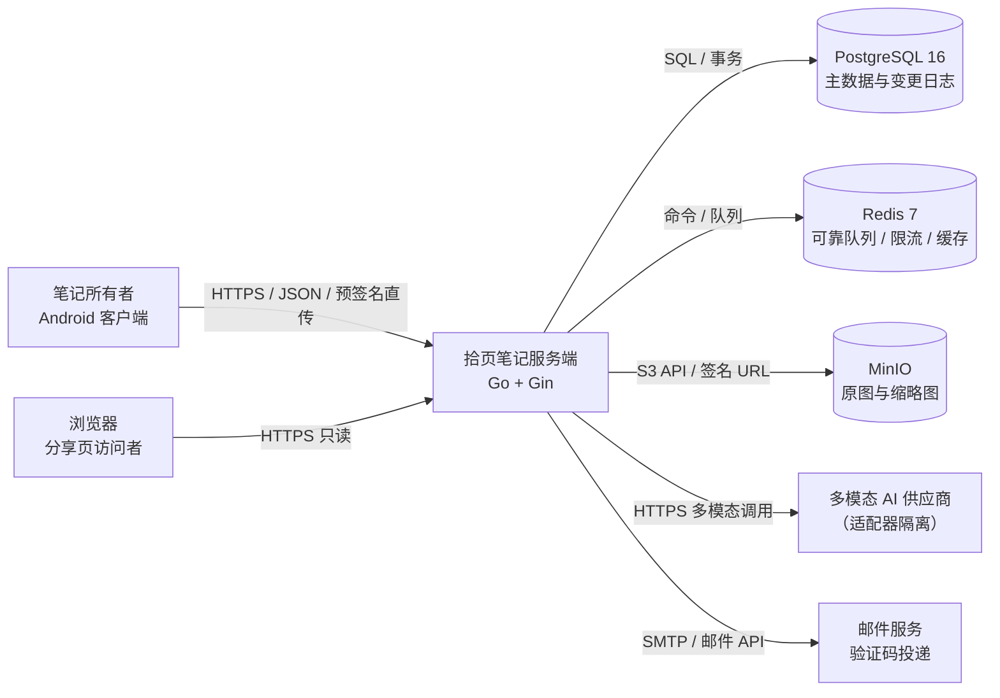

边界说明：

- **客户端只与三类端点交互**：业务 API（`/v1/*`）、MinIO 预签名地址（图片直传直读）、分享页（`/s/{token}` 与 `/v1/public/*`）。客户端不持有 MinIO 凭证，也不直连数据库与 Redis。
- **AI 供应商在系统边界之外**，通过 `application/port` 定义的 `VisionProvider` 接口调用；供应商故障只影响转换任务，不影响读写主链路。
- **邮件服务**只承担验证码投递，失败时按 PRD FR-01 的异常分支处理，不阻塞注册主流程以外的功能。

## 4. 解决方案策略（arc42 §4）

| 决策主题 | 策略 | 理由 |
|---|---|---|
| 形态 | 模块化单体（Modular Monolith），单二进制部署 | 2C4G 下分布式带来的运维成本远高于收益；分层清晰后可平滑拆出转换 Worker |
| 架构风格 | 六边形（端口与适配器）+ 轻量 DDD | 领域逻辑不被 Gin、PG、MinIO 污染，便于单测与替换供应商 |
| 数据存储 | PostgreSQL 16 作为唯一权威库；Redis 只做队列、限流、短缓存 | 避免缓存成为一致性来源；PG 的 JSONB、递归 CTE、部分唯一索引正好覆盖本系统需求 |
| 图片存储 | MinIO（S3 兼容），客户端持预签名 URL 直传 | 图片流量不经过应用进程，2C4G 的带宽与内存压力显著下降；S3 语义为未来切换 OSS 留出零改动空间 |
| 异步转换 | Redis 列表（BLMOVE 可靠队列），任务按用户串行 | BLMOVE 取任务时保留在途副本，启动 `Recover` 回收、补偿协程重投；「同一用户同时最多 1 个处理中」用队列 + 数据库唯一约束双重保证 |
| 同步模型 | 服务端权威 + 变更日志增量拉取 + 客户端重放 | 离线编辑是 PRD P0 恢复路径的硬要求，必须能按序重放且可去重 |
| 冲突处理 | 乐观锁 + 先提交内容生成冲突副本 | 与 PRD 5.5 一致：后提交者覆盖，先提交内容不丢失 |
| 鉴权 | 短期 Access Token + 轮换 Refresh Token | 移动端长登录态与可撤销能力兼顾 |
| 接口风格 | 资源导向 REST + AIP 自定义方法 + RFC 9457 错误体 | 与客户端约定稳定、错误可编程处理、文档可由契约生成 |

## 5. 构建块视图（arc42 §5）

### 5.1 容器视图（C4 Level 2）

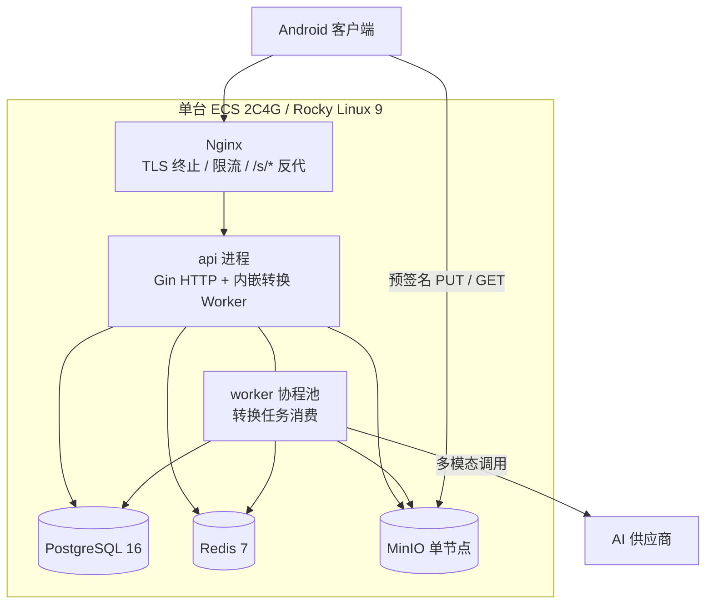

`api` 与 `worker` 在同一进程内以不同 goroutine 池运行：部署简单、共享连接池，且可在压测或故障隔离需要时通过开关拆成两个进程（同一份二进制，`GN_MODE=api|worker|all`）。

### 5.2 代码结构与依赖规则

目录布局遵循 Go 官方「Organizing a Go module」与社区通行的 `cmd / internal / pkg` 约定（S14），`internal` 由编译器强制禁止外部导入。

```text
GleanNote/
├── cmd/
│   └── api/                    # 唯一入口：装配依赖、启动 HTTP 与 Worker
├── internal/
│   ├── config/                 # 配置加载与校验（环境变量优先）
│   ├── bootstrap/              # 依赖装配、迁移执行、优雅退出
│   ├── transport/
│   │   └── http/               # Gin 路由、中间件、请求/响应 DTO、处理器
│   ├── application/
│   │   ├── port/               # 端口定义：仓储、对象存储、AI、邮件、时钟
│   │   └── usecase/            # 用例：auth、folder、note、upload、conversion、
│   │                           #        trash、sync、tag、version、share、search、quota
│   ├── domain/
│   │   ├── entity/             # 实体与状态机
│   │   ├── valueobject/        # 值对象：Email、Revision、PageOrder、QuotaDate
│   │   ├── service/            # 领域服务：目录树、额度、容量、冲突裁决
│   │   └── errs/               # 领域错误码（可映射到 HTTP）
│   ├── infrastructure/
│   │   ├── postgres/           # 仓储实现 + 内嵌 SQL 迁移（migrations/）
│   │   ├── memory/             # 进程内实现：测试与离线开发的默认选择
│   │   ├── redis/              # 固定窗口限流、失败守卫、幂等、黑名单、转换队列
│   │   ├── objectstore/        # MinIO / S3 适配器
│   │   ├── vision/             # AI 供应商适配器（可插拔）
│   │   ├── mail/               # SMTP / 邮件 API 适配器
│   │   └── obs/                # 日志、指标、链路
│   └── platform/               # 跨用例的纯技术工具：idgen、clock、pagetoken、problem
├── migrations/                 # PostgreSQL 迁移脚本（只增不改）
├── deploy/                     # docker-compose、systemd、nginx 配置
├── docs/                       # 本文档体系
└── .gitignore
```

依赖规则（违反即评审不通过）：

1. 依赖方向只能是 `transport → application → domain`；`infrastructure` 只被 `bootstrap` 装配，`domain` 不得导入任何外部框架。
2. `domain` 不得出现 `gin`、`pgx`、`minio`、`redis` 等字样。
3. `application` 只依赖 `application/port` 中的接口，不直接依赖具体实现。
4. 跨用例共享的纯函数放 `platform`，禁止把业务规则放进去。
5. `internal` 之外不新增包；`pkg/` 目录本期不建立，避免过早固化对外 API。

### 5.3 构建块职责

| 构建块 | 职责 | 不负责 |
|---|---|---|
| transport/http | 协议解析、参数校验、鉴权上下文、DTO 转换、错误体渲染 | 业务规则、事务边界 |
| application/usecase | 编排：事务、权限校验、领域服务调用、事件写入 | SQL 语句、HTTP 细节 |
| domain | 实体状态机、不变量、领域错误、冲突裁决 | 读写持久化 |
| infrastructure/postgres | 仓储实现、SQL、索引、迁移 | 业务判断 |
| infrastructure/redis | 固定窗口限流、失败守卫、幂等快照、令牌黑名单、转换队列 | 作为数据权威；业务实体仍由 postgres 承载 |
| infrastructure/objectstore | 预签名、对象校验、缩略图生成、对象删除 | 容量归属判断 |
| infrastructure/vision | 供应商协议适配、超时、错误归一 | 任务调度与额度 |
| infrastructure/pdfdoc | 导出 PDF 的版式排版与字节组装 | 导出任务状态、对象写入、下载地址签发 |
| transport/http + obs | 请求 ID、日志、指标、追踪 | 业务语义 |

### 5.4 领域对象与状态机

对象关系沿用 PRD 3.2 节，服务端补充三个技术字段：`revision`（笔记）、`delete_batch_id`（删除批次）、`purge_at`（到期清理时间）。

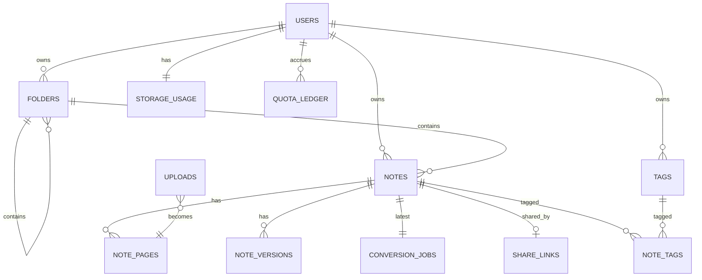

笔记与目录的状态机严格按 PRD 3.3 实现，服务端只做三件事：拒绝非法迁移、记录迁移时间、在迁移时写入变更日志。

| 状态对（源 → 目标） | 触发 | 服务端副作用 |
|---|---|---|
| DRAFT → NORMAL | 首次保存或转换成功自动保存 | revision +1、写版本、写变更日志 |
| DRAFT / NORMAL → DELETED | 用户删除或父目录删除 | 置 `deleted_at`、`purge_at = deleted_at + 30 天`、写删除批次、失效分享链接 |
| DELETED → NORMAL | 恢复 | 重新计算 `folder_id`、写变更日志、分享链接保持失效 |
| DELETED → 不存在 | 彻底删除或到期清理 | 删除正文、页面对象、版本、标签关联 |

### 5.5 数据模型（PostgreSQL 16）

命名与约束统一口径：表名复数、列名蛇形、主键 UUIDv7（时间有序，避免 B-Tree 随机写）、所有时间列 `timestamptz`、金额与字节数用 `bigint`。

| 表 | 关键列 | 关键约束与索引 |
|---|---|---|
| users | id, email, password_hash, nickname, status, email_verified_at, created_at, updated_at, deleted_at | `unique(email)`；`deleted_at` 为空时邮箱可复用（注销即物理删除用户行） |
| email_codes | id, email, purpose, code_hash, expires_at, attempts, consumed_at, created_at | `index(email, purpose, created_at desc)` |
| refresh_tokens | id, user_id, token_hash, device_id, expires_at, revoked_at, replaced_by | `index(user_id, device_id)`；`unique(token_hash)` |
| folders | id, user_id, parent_id, name, depth, path, sort_order, revision, deleted_at, delete_batch_id, purge_at, created_at, updated_at | `unique index(user_id, coalesce(parent_id, zeros), lower(name)) where deleted_at is null`；`check(depth between 1 and 5)`；`index(user_id, path)` |
| notes | id, user_id, folder_id, title, content_md, state, revision, char_count, tsv, deleted_at, delete_batch_id, purge_at, created_at, updated_at | `index(user_id, folder_id, updated_at desc)`；`index(user_id, state)`；`gin(tsv)`；`check(char_count <= 200000)` |
| note_pages | id, note_id, user_id, page_index, object_key, thumb_key, bytes, width, height, sha256, deleted_at, created_at | `unique(note_id, page_index) where deleted_at is null`；`index(note_id, page_index)` |
| uploads | id, user_id, object_key, bytes, content_type, sha256, width, height, status, expires_at, created_at | `index(user_id, created_at)`；过期由定时任务清理 |
| conversion_jobs | id, note_id, user_id, kind, state, total_pages, processed_pages, failure_code, quota_charged, attempt, started_at, finished_at, created_at, updated_at | 部分唯一索引 `unique(user_id) where state = 'RUNNING'`；`index(note_id, created_at desc)` |
| tags | id, user_id, name, note_count, created_at, updated_at | `unique(user_id, lower(name))` |
| note_tags | note_id, tag_id, user_id, created_at | `pk(note_id, tag_id)`；`index(tag_id)` |
| note_versions | id, note_id, user_id, content_md, char_count, source, created_at, expires_at | `index(note_id, created_at desc)`；`index(expires_at)` |
| share_links | id, note_id, user_id, token, enabled, created_at, updated_at | `unique(note_id)`、`unique(token)` |
| trash_batches | id, user_id, root_type, root_id, folder_count, note_count, deleted_at, purge_at | `index(user_id, deleted_at desc)` |
| storage_usage | user_id, used_bytes, updated_at | `pk(user_id)`；与页面写入同事务更新 |
| quota_ledger | id, user_id, quota_date, delta, reason, job_id, created_at | `unique(job_id, reason)` 保证返还幂等；`index(user_id, quota_date)` |
| change_log | seq, user_id, resource_type, resource_id, op, revision, payload, created_at | `pk(seq bigserial)`；`index(user_id, seq)` |
| idempotency_keys | user_id, key, endpoint, request_hash, status, body, created_at, expires_at | `pk(user_id, key)`；24 小时后清理 |

当前实现以 `internal/infrastructure/postgres/migrations/0001_init.sql` 为准，与上表的差异：正文列名为 `content`（不含 `tsv`，中文检索用 `strpos(lower(...))` 连续匹配）；额度拆为 `quota_usage`（按 `user_id + quota_date` 累计 used）与 `quota_charges`（以 `pk(user_id, job_id)` 做幂等并记录 `refunded_at`）；变更日志拆为 `change_events`、`change_seq` 与 `change_watermarks`（清理水位）；回收站批次信息落在 `folders`/`notes` 的 `delete_batch_id` 与 `purge_at`，不再单设 `trash_batches`；幂等快照由 Redis 承载而非数据库表。

设计要点：

1. **目录路径物化**：`path` 存为 `/{rootId}/{childId}/...`，移动目录时用递归 CTE 批量重写子树路径，使面包屑、子树查询与「禁止移动到子孙」判断都退化为前缀匹配。
2. **变更日志与业务写入同事务**：任何影响同步的写操作（目录、笔记、标签、页面）都在同一事务内插入 `change_log`，保证「已应答即可被拉到」。
3. **额度账本不可变**：只追加 `delta`，当日剩余额度 = 上限 + SUM(delta)，同时用 Redis 计数做快速校验，二者以账本为准，冲突时以账本回填缓存。
4. **搜索**：`tsv` 用 `simple` 配置覆盖英文单词检索；中文按 PRD 的「连续字符匹配」使用 `pg_trgm` 的 `gin_trgm_ops` 索引做 `ILIKE '%关键词%'`。不引入分词插件，避免在 2C4G 上增加运维面（风险见 11 章）。
5. **大字段**：`content_md` 上限 20 万字符（PRD 5.2），使用 `text` + `TOAST`；列表接口绝不返回正文，避免带宽放大。

### 5.6 页面图片管线


管线约定：

- 客户端负责元数据剥离与压缩（PRD FR-04），服务端只做**校验与缩略图**，不再二次压缩，避免两份画质损失与 CPU 峰值。
- `complete` 阶段的校验必须包括：对象存在性、字节数与声明一致、`sha256` 一致、魔数解码成功、像素总数上限（4000 万像素，防解压炸弹）。
- 缩略图在服务端生成并独立存 key（`thumb/` 前缀），因为列表页需要稳定的小图，不能让每个客户端各自解码原图。
- 原图与缩略图均通过 10 分钟有效的预签名 GET 暴露；对象桶为私有，不配置匿名读。
- 存储计量只统计原图 `bytes`（PRD 5.3.1），缩略图不计入 200MB 上限。

## 6. 运行时视图（arc42 §6）

### 6.1 注册与登录

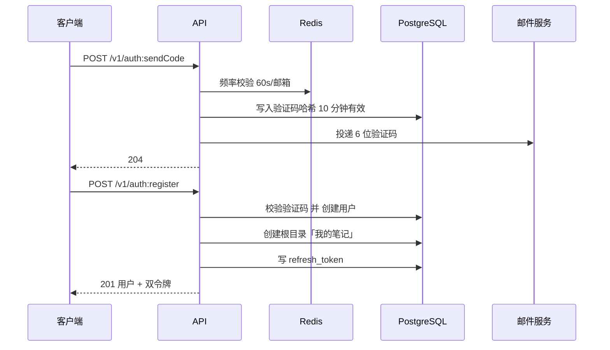

登录失败计数、验证码发送频率与令牌黑名单都放 Redis，键均带 TTL；同一邮箱与同一客户端 IP 连续 5 次密码错误锁定 15 分钟（PRD FR-01），锁定期内直接返回 `AUTH_TOO_MANY_ATTEMPTS`，不再查库。失败计数绑定来源，避免攻击者用错误口令定向锁死他人账号。

### 6.2 图片上传到转换完成

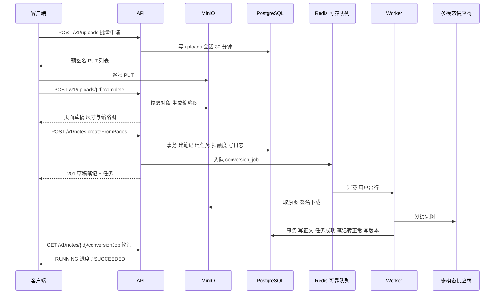

失败、取消、超时三条路径都在**同一事务**内完成三件事：任务状态落库、额度返还入账本（`unique(job_id, reason)` 保证幂等）、笔记状态保持草稿。PRD 要求的「重试复用已上传图片」等价于：重试只新建任务，不新建页面。

### 6.3 保存与冲突裁决

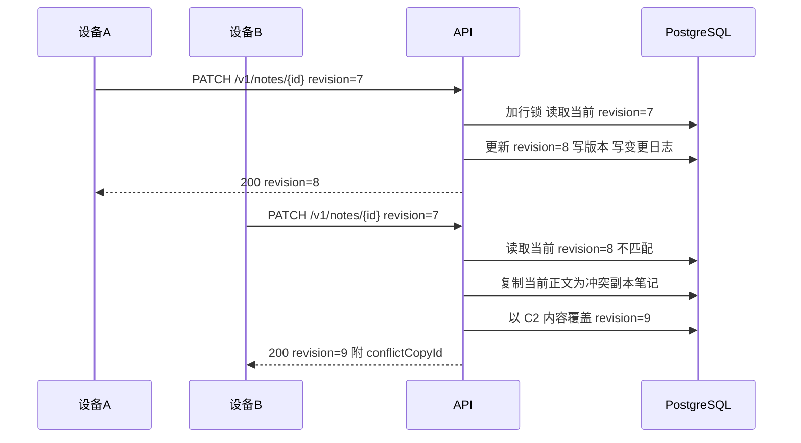

裁决规则与 PRD 5.5 一一对应；服务端在响应中显式返回 `conflictCopyId`，客户端据此提示「已保留副本」，不依赖轮询发现。

### 6.4 回收站恢复与到期清理

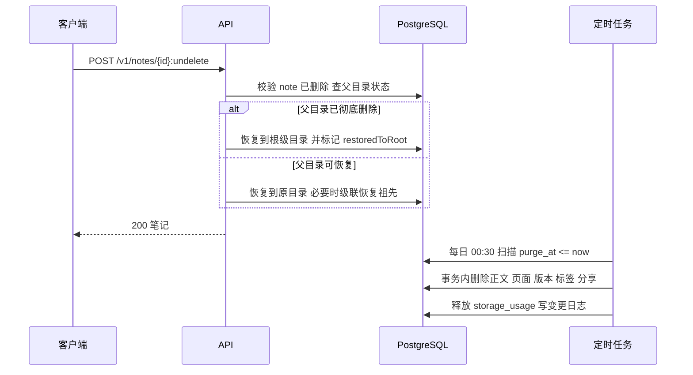

目录恢复按「批次」执行：`trash_batches` 记录被删子树的根与计数，恢复时按批次恢复整棵子树，避免逐条恢复导致的层级断裂。

### 6.5 增量同步

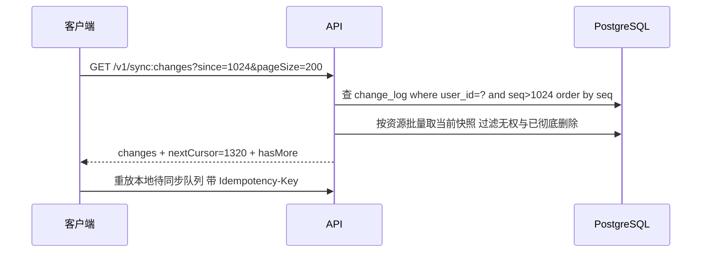

`nextCursor` 只在响应成功时前进；客户端必须先落库再推进游标。删除事件以墓碑形式下发（`op=DELETE`），客户端据此清理本地缓存。

### 6.6 分享页访问

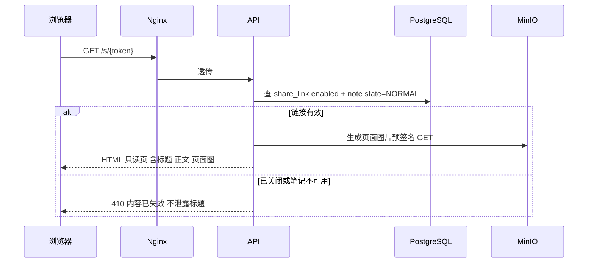

分享页是唯一的匿名入口：只返回单篇笔记的标题、正文、页面图片，不返回目录路径、标签、作者信息与其他笔记（PRD 5.7）。服务端以纯文本在 `<pre>` 中转义输出 Markdown 源码，不解析 Markdown 与 HTML；JSON 端点与页面均返回 `Cache-Control: no-store`，撤销即时生效。

### 6.7 导出（FR-14）

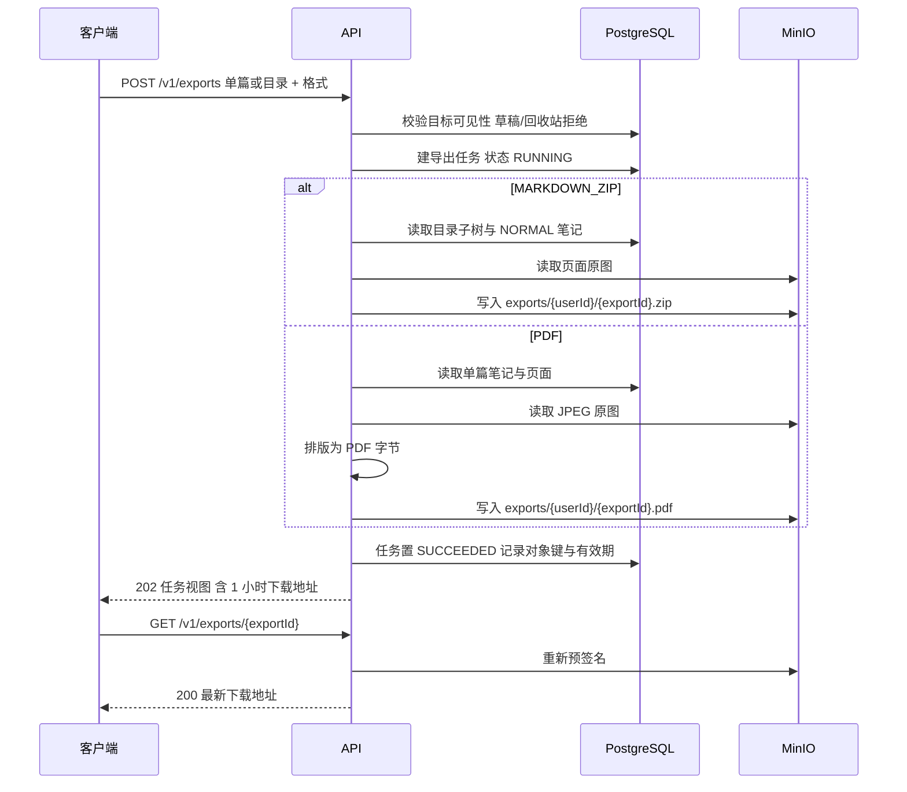

导出约定：

- **当前阶段同步生成**：`POST` 在请求内完成归档并返回 `202`，任务可能已是 `SUCCEEDED` 或 `FAILED`；后续迁入 Worker 时状态机与外层契约不变，`GET` 轮询语义已经就绪。
- 下载地址每次查询都重新预签名（有效期 1 小时），避免任务记录中的旧地址过期后不可用。
- 归档生成不消耗额度、不计容量、不写版本；生成失败只记录失败码（如 `IMAGE_UNREADABLE`），不产生半成品下载地址。
- 文件名按 FR-14 规则清洗非法字符、空标题回落「未命名笔记」、同目录同名追加 ` (2)`；压缩包时间戳固定，保证同内容字节稳定。
- PDF 由 `infrastructure/pdfdoc` 渲染：A4 版式、预定义 CJK 字体（`STSong-Light` + `UniGB-UCS2-H`）避免嵌入字体文件，仅 JPEG 以 `DCTDecode` 嵌入，其他格式跳过。渲染器只依赖 `application/port.PDFRenderer`，不反向依赖用例。

### 6.8 批量导入（FR-17）

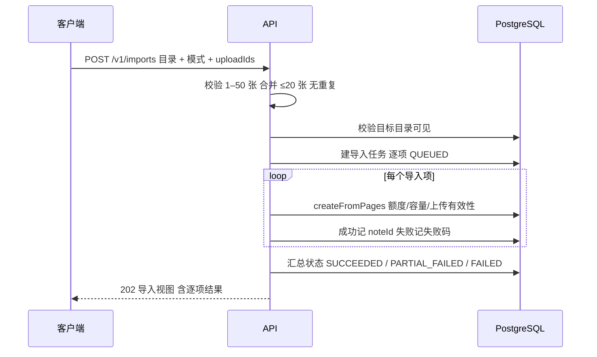

导入约定：

- 串行处理，单项失败不阻断后续项，整体状态按成功/失败计数落定；单项 `SUCCEEDED` 表示「草稿已创建且转换任务已提交」，不等待转换完成。
- `MERGE` 只调用一次 `createFromPages`，所有导入项共享同一 `noteId`；失败时统一记录同一失败码。
- 复用笔记用例的额度、容量与上传有效性校验，导入模块不重复实现写入规则。

## 7. 部署视图（arc42 §7）

### 7.1 单机拓扑

| 组件 | 监听 | 运行方式 | 说明 |
|---|---|---|---|
| Nginx | 443 / 80 | systemd | TLS 终止、HSTS、请求体上限 12MB、`/s/*` 反代 |
| api | 0.0.0.0:8080 | systemd（`GN_MODE=all`） | Go 单二进制，含 HTTP 与 Worker |
| PostgreSQL 16 | 127.0.0.1:5432 | systemd | `shared_buffers=512MB`、`max_connections=50`、`work_mem=8MB` |
| Redis 7 | 127.0.0.1:6379 | systemd | `maxmemory=256MB`、`maxmemory-policy=noeviction`（队列数据不可淘汰） |
| MinIO | 127.0.0.1:9000 | systemd | 数据目录 `/data/minio`，单节点单盘，开启版本化 |

只有 Nginx 对公网开放；api 监听 `0.0.0.0` 但由安全组与 `firewalld` 限制为仅 Nginx 所在网络可访问，数据库与对象存储仍绑定回环地址。

### 7.2 资源预算（2C4G 可行性说明）

| 组件 | 常驻内存预算 | 关键限制 |
|---|---|---|
| OS + Nginx | 600MB | 关闭无关服务，日志轮转 7 天 |
| api | 350MB | `GOMEMLIMIT=300MiB`、`GOGC=100`，单请求体上限 12MB |
| PostgreSQL | 750MB | 连接池上限 40，应用侧 `MaxConns=20` |
| Redis | 320MB | 队列积压监控，超过 5000 条告警 |
| MinIO | 500MB | 单盘，容量 ≥ 250GB |
| 余量 | ≈ 1.5GB | 留给页缓存与流量突发 |

结论：2C4G 可支撑首年约 1000 账号、100 并发以内的规模；当 MinIO 容量或 CPU 成为瓶颈时，按 11.2 的路线图外置对象存储与数据库，应用层无需改动（对象存储与数据库均已抽象为端口）。

### 7.3 备份与恢复

| 对象 | 方式 | 频率 | RPO / RTO |
|---|---|---|---|
| PostgreSQL | `pg_dump` 全量 + WAL 归档 | 全量每日 02:00，WAL 每小时 | ≤ 1h / ≤ 2h |
| MinIO | 每日 `mc mirror` 到异地 OSS 或另一台主机 | 每日 03:00 | ≤ 24h / ≤ 2h |
| 配置与密钥 | 密码管理器 + 部署仓库外加密备份 | 变更时 | — |

恢复演练每季度一次，演练项固定为：仅用备份在新主机恢复服务并跑通 P0 冒烟用例。

### 7.4 环境与配置

配置来源优先级：环境变量 > 内置默认值。所有密钥只走环境变量，仓库中只允许出现 `.env.example` 的占位值。配置项清单见附录 A。`configs/{env}.yaml` 的分层配置留作后续演进，当前实现不读取该文件，避免出现「配置了却不生效」的歧义。

## 8. 横切概念（arc42 §8）

本章是本文档约束密度最高的部分，所有模块必须遵守，不允许按模块例外。

### 8.1 资源命名与路径

- 版本前缀：`/v1`，版本只出现在路径（AIP-185）。
- 集合路径用复数名词：`/v1/notes`、`/v1/folders`、`/v1/tags`；子资源用父资源前缀：`/v1/notes/{noteId}/pages`。
- 无法用标准方法表达的动作用自定义方法，形如 `POST /v1/notes/{noteId}:move`、`POST /v1/uploads/{uploadId}:complete`（AIP-136）。自定义方法一律 `POST`，动作用冒号后的小驼峰动词，**不得**用介词短语或 RPC 风格路径。
- 资源标识符使用 UUIDv7 字符串，不使用自增数字，避免枚举与迁移冲突；分享链接使用 32 字节 CSPRNG 的 Base64URL，禁止可推导。
- JSON 字段一律 `camelCase`，枚举值一律 `UPPER_SNAKE_CASE`，时间一律 RFC 3339 UTC（`Z` 结尾），展示层再做北京时间转换。

### 8.2 错误模型

所有错误响应（含 4xx 与 5xx）统一为 `application/problem+json`，结构遵循 RFC 9457，扩展成员对齐 AIP-193：

| 成员 | 必选 | 说明 |
|---|---|---|
| `type` | 是 | 稳定 URI，形如 `https://gleannote.example/problems/quota-exceeded` |
| `title` | 是 | 面向开发的英文短语 |
| `status` | 是 | HTTP 状态码 |
| `detail` | 是 | 面向开发的英文细节，不承载需解析的变量 |
| `instance` | 是 | 本次请求 URI + 请求 ID |
| `code` | 是 | 稳定业务错误码，`UPPER_SNAKE_CASE`，客户端按此分支 |
| `userMessage` | 是 | 面向终端用户的中文提示，可含占位变量 |
| `metadata` | 否 | 键值对，承载动态上下文（上限、剩余额度、冲突副本 ID 等） |
| `retryable` | 是 | 布尔，客户端可否直接重试 |
| `retryAfterSeconds` | 否 | `retryable=true` 时的建议间隔 |
| `requestId` | 是 | 与服务端日志可关联的请求 ID |

规则：

1. 客户端**不得**解析 `detail` 或 `userMessage` 取业务变量，变量必须放在 `metadata`。
2. 同一 `code` 的 HTTP 状态码不得变化；`code` 与 `userMessage` 的映射表见 [API.md](API.md) 第 6 章。
3. 5xx 必须返回 `retryable=true` 且不得泄露堆栈、SQL、内部主机名。
4. 越权访问他人资源返回 `404 RESOURCE_NOT_FOUND` 而非 403，以防止资源枚举；真正的权限不足（如令牌缺少 scope）才返回 403。此项为对 AIP-193「先权限后存在」的有意偏离，理由见 ADR-014。

### 8.3 分页、过滤与排序

- 分页严格遵循 AIP-158：请求 `pageSize`（可选，默认 20，最大 100，负数报错，超限自动收敛）、`pageToken`（不透明字符串）；响应 `items`、`nextPageToken`（为空表示结束）、`totalSize`（可选，估算值必须标注）。
- `pageToken` 为 Base64URL 编码的签名串，内含排序键与偏移快照，有效期 1 小时；篡改或过期返回 `INVALID_PAGE_TOKEN`。
- 过滤采用显式强类型查询参数（`folderId`、`state`、`tagIds`、`updatedAfter`），不暴露通用过滤表达式语法；AIP-160 的字符串语法留作 P1 演进，且只能在新增参数名下引入（S5、S9）。
- 排序通过 `orderBy` 白名单枚举：`updateTime desc`（默认）、`createTime desc`、`title asc`。非白名单值返回 `VALIDATION_FAILED`。排序键必须包含唯一的次级键 `id`，保证翻页稳定。

### 8.4 幂等与并发

- 创建类操作（注册、创建笔记、提交转换、创建目录、开启分享）必须支持 `Idempotency-Key` 请求头：同用户 + 同键 + 同请求体 24 小时内返回首次结果；同键不同体返回 `409 IDEMPOTENCY_KEY_REUSED`。
- 更新笔记与目录使用**修订号乐观锁**：请求体携带 `revision`（或 `If-Match: "rev-7"`）。不匹配时按 6.3 的冲突裁决执行，不返回 412 给客户端（笔记场景）；目录改名等无冲突语义的更新在不匹配时返回 `412 REVISION_MISMATCH`。
- 目录移动、删除、恢复等结构性操作在同一用户维度加事务级 advisory lock（`pg_advisory_xact_lock(hashtext(user_id))`），把「同用户目录树变更」串行化，避免路径物化写入竞态。
- 重试安全边界：`GET/HEAD/PUT/DELETE` 天然幂等；`POST` 必须依赖 `Idempotency-Key` 才可重试；上传 `PUT` 预签名地址天然幂等。

### 8.5 时间、时区与日期

- 数据库一律 `timestamptz`，应用内一律 `time.Time`（UTC），序列化一律 RFC 3339。
- 业务日期（额度日、回收站剩余天数、版本保留期）一律按 `Asia/Shanghai` 计算（PRD 5.8）。
- 所有时间获取必须通过 `platform/clock` 的 `Clock` 接口，禁止业务代码直接调用 `time.Now()`，以便测试注入。
- 手机端展示的相对时间由客户端计算，服务端只返回绝对时间，避免服务端承担展示逻辑。

### 8.6 认证与授权

- 注册：邮箱 + 6 位验证码 + 密码（8–32 位，字母与数字同时存在）；验证码只存哈希（HMAC-SHA256 + 服务端密钥），10 分钟过期，同邮箱 60 秒一次，连续错 5 次作废。
- 密码存储：Argon2id（`m=64MiB, t=3, p=2`），每用户独立随机盐（S15）。禁止 MD5/SHA1/裸 SHA256。
- Access Token：JWT，签名算法 EdDSA（Ed25519），有效期 15 分钟，载荷含 `sub`（用户 ID）、`jti`、`exp`、`deviceId`。
- Refresh Token：不透明随机串，只存哈希，有效期 30 天，**每次使用即轮换**；旧令牌立即失效并记录 `replaced_by`，检测到复用则吊销该设备全部令牌（令牌重放防护）。
- 退出登录：吊销当前设备 Refresh Token 并把 Access Token 的 `jti` 写入 Redis 黑名单（TTL = 剩余有效期）。
- 授权：所有权校验在应用层做，所有仓储查询强制携带 `user_id` 条件；**任何**按 ID 取单条资源的 SQL 都必须带 `user_id`，代码评审重点检查项。
- 未登录仅可访问：`/v1/auth:*`、`/v1/public/*`、`/s/{token}`、`/healthz`。

### 8.7 限流与防滥用

| 维度 | 限额 | 存储 |
|---|---|---|
| 全局单 IP | 600 请求/分钟 | Redis 令牌桶 |
| 登录接口 | 10 次/分钟/IP + 5 次/账号（失败） | Redis |
| 验证码发送 | 1 次/60 秒/邮箱；10 次/天/邮箱 | Redis |
| 写接口 | 120 次/分钟/用户 | Redis |
| 上传会话 | 100 张/小时/用户 | Redis |
| 并发转换 | 1 个 RUNNING/用户 | 数据库部分唯一索引 + Redis 锁 |

超限返回 `429 RATE_LIMITED`，附 `Retry-After`。限流键统一 `rl:{scope}:{identity}`，禁止把邮箱明文写入 Redis 键（用 HMAC 摘要）。

### 8.8 额度与容量

- 日额度 50 张，提交时扣减，失败/取消/超时返还（PRD 5.3）。扣减与返还都以 `quota_ledger` 追加流水实现，Redis 只做当日余额的读缓存，缓存失效即回源账本重算。
- 云端容量 200MB/账号，按原图 `bytes` 累计（PRD 5.3.1）。`storage_usage.used_bytes` 与 `note_pages` 写入同事务维护，并提供每 6 小时的核对任务，对账不一致时以 `SUM(note_pages.bytes)` 修正并告警。
- 回收站内容继续占用容量；彻底删除与到期清理释放容量。
- 达到 90% 只提示不阻断；达到 100% 阻断「新建转换」和「追加页面」，不阻断编辑与阅读。

### 8.9 缓存策略

- 原则：缓存**不是**任何数据的权威，任何缓存键都必须有明确的失效触发点。
- 允许缓存的内容：当日额度余额（TTL 5 分钟 + 写后删）、用户基础信息（TTL 10 分钟 + 写后删）、分享链接解析结果（TTL 60 秒）、目录树结构（TTL 60 秒，用户级）。
- 禁止缓存的内容：笔记正文、页面原图、任务状态（任务状态必须实时读库，保证进度准确）。
- 缓存键统一 `c:{domain}:{userId}:{key}`，不得包含 PII 明文。

### 8.10 软删除、回收站与保留期

严格遵循 AIP-164 的语义：`DELETE` 只打标记；恢复用 `:undelete`；彻底删除用 `:expunge`；列表默认不返回已删除资源，回收站通过独立端点列出。

- 删除目录时生成一个 `trash_batches` 记录，子树内所有目录与笔记共享同一 `delete_batch_id`，回收站列表按批次聚合展示为一条记录（PRD FR-09）。
- 保留期 30 天，`purge_at = deleted_at + 30 天`。到期清理任务每日 00:30 执行，单批处理上限 200 条，避免长事务。
- 恢复目录时若原父目录已被彻底删除，整批恢复到根级并返回 `restoredToRoot=true`。
- 恢复时若同级存在同名目录，名称追加 ` (2)`、` (3)`，直到不冲突（PRD FR-09）。

### 8.11 日志、指标与追踪

- 日志：结构化 JSON（`log/slog`），字段固定为 `ts`、`level`、`msg`、`requestId`、`traceId`、`userId`、`route`、`status`、`durationMs`、`errorCode`。邮箱、密码、令牌、验证码一律脱敏或不出现在日志中。
- 追踪：接受 W3C `traceparent`，无则生成；跨进程（Worker → AI 供应商）透传。
- 指标（Prometheus `/metrics`，仅内网）：`http_requests_total{route,status}`、`http_request_duration_seconds`、`conversion_jobs_total{state}`、`conversion_duration_seconds`、`quota_charged_total`、`storage_used_bytes`、`conversion_queue_depth`、`db_pool_in_use`。
- 告警（最低集合）：5xx 比率 > 1% 持续 5 分钟；转换失败率 > 10% 持续 10 分钟；队列积压 > 5000；磁盘使用率 > 80%；到期清理任务未在 00:45 前完成。
- 审计：删除、彻底删除、注销、分享开关四类操作写入 `audit_logs`（P1 落地，字段设计见附录 B）。

### 8.12 安全与隐私

- 传输：强制 HTTPS，HSTS 180 天，仅允许 TLS 1.2+。
- 上传：校验魔数、声明类型与解码结果三者一致；限制像素总数与字节数；HEIC 由客户端转 JPEG 后上传（PRD FR-03）。
- XSS：分享页不渲染 Markdown/HTML，正文按纯文本转义输出；CSP 禁止脚本与外部资源。
- SSRF：服务端不请求任何用户提供的 URL；AI 适配器只访问固定供应商域名。
- 越权：所有按 ID 查询强制带 `user_id`；批量接口逐条校验归属。
- 隐私：注销即物理删除用户行与全部关联数据（PRD FR-01），MinIO 对象异步删除并记录补偿任务；日志保留 30 天。

### 8.13 一致性与事务边界

- 一个用例一个事务；事务只包裹数据库操作，**不得**在事务内发起网络调用（AI、邮件、MinIO）。涉及外部调用的流程一律拆成「先落库 → 提交 → 发消息」。
- 事务内必须写入 `change_log`（影响同步时）与必要的 `quota_ledger`、`storage_usage` 变更，保证单一事务内的账实一致。
- 对象存储与数据库之间无分布式事务，采用「数据库先行 + 补偿」：先写业务行与 `storage_usage`，再删除对象；对象删除失败进入后台补偿流程（低优先后台任务），并有每日对账任务扫描孤儿对象（存在对象但无 `note_pages` 引用超过 1 小时）与缺失对象（有引用但对象不存在，标记 `MISSING` 并告警）。
- 读写分离不做；单库单写，靠索引与分页保证性能。

### 8.14 注释与文档分工（摘要）

本节只规定「架构层面必须统一」的部分，完整规则见 [CONVENTIONS.md](CONVENTIONS.md)。

- 文档承担：标准、规范、约定、决策、接口契约与产品规则。
- 代码注释承担：本段代码的意图、约束、非显然原因、对文档章节的引用。
- 代码注释一律使用块注释 `/* ... */`，禁止 `//` 行注释（编译器指令 `//go:build`、`//go:generate` 等除外）；每段被注释覆盖的连续代码不超过 15 行。
- 注释与文档互相引用时使用固定标签：`@doc docs/ARCHITECTURE.md#82-错误模型`、`@see docs/API.md#6-错误码目录`、`@risk`、`@todo(#issue)`。
- 注释语言为中文，标识符与协议字段保留英文原名。

### 8.15 版本与兼容

- URL 版本 `v1` 冻结后仅允许向后兼容变更：新增可选字段、新增枚举值（客户端必须容忍未知枚举）、新增端点、放宽校验（S9）。
- 破坏性变更必须升 `v2`，且 `v1` 至少并行 6 个月。
- 客户端必须容忍：未知字段、未知枚举值、字段顺序变化、`nextPageToken` 为空、错误 `metadata` 新增键。
- 废弃流程：响应头 `Deprecation` + `Sunset`（RFC 8594），并在 [API.md](API.md) 修订记录中登记。

### 8.16 付费第三方服务的端口与 Fake 策略

所有按量计费的第三方能力在服务端代码中只以端口形式出现，供应商实现放在 `internal/infrastructure/<capability>/`，由启动装配按名称选择；业务代码与传输层不得直接引用任何供应商 SDK。视觉已提供 `fake` 与 `deepseek`（OpenAI 兼容多模态）两种实现，默认 `fake`；邮件仍只装配 Fake；对象存储使用自托管的 MinIO，已通过 S3 适配器真实对接。

| 能力 | 端口 | 当前实现 | 生产要求 | 相关配置 |
|---|---|---|---|---|
| 图片 → Markdown | `port.VisionProvider` | `vision.NewFake`：确定性正文、偶数页标记未识别、可注入延迟与故障；`vision.NewDeepSeek`：OpenAI Chat Completions 兼容，按页内联图片并还原版式 | 生产使用 DeepSeek 或同协议适配器 | `GN_VISION_PROVIDER`、`GN_VISION_API_KEY`、`GN_VISION_BASE_URL`、`GN_VISION_MODEL`、`GN_VISION_REQUEST_TIMEOUT`、`GN_FAKE_VISION_LATENCY`、`GN_FAKE_VISION_FAILURE` |
| 邮件（验证码） | `port.Mailer` | `mail.NewFake`：单行 JSON 写入标准输出，不投递；默认对邮箱与验证码脱敏，`GN_FAKE_MAIL_REVEAL_CODE=true` 时输出明文供本地手工联调 | 必须替换为真实适配器 | `GN_MAILER_PROVIDER`、`GN_FAKE_MAIL_REVEAL_CODE` |
| 对象存储 | `port.ObjectStore` | `objectstore.NewMinIO`：本地容器 MinIO，S3 兼容；Fake 仅供单元测试 | MinIO 或同语义 S3 兼容存储 | `GN_OBJECT_STORE_PROVIDER`、`GN_S3_ENDPOINT`、`GN_S3_BUCKET`、`GN_S3_ACCESS_KEY`、`GN_S3_SECRET_KEY`、`GN_S3_REGION`、`GN_S3_USE_SSL` |

规则：

1. 名称解析只接受已注册实现；未实现名称在装配期返回 `ErrProviderNotConfigured` 并终止启动，禁止回落到 Fake 掩盖配置错误（ADR-006）。
2. `GN_ENV=staging|prod` 时出现任一 Fake 提供者，启动立即失败。校验位于 `internal/bootstrap`，不依赖运维纪律或部署检查表。
3. Fake 必须满足端口语义：结果确定性、不访问网络、不依赖系统时钟（延迟可注入）、错误一律映射为 `port` 包哨兵错误。
4. 故障演练只通过环境变量注入，不改代码：`GN_FAKE_VISION_FAILURE` 取值 `unavailable`、`unreadable`、`unsupported`。
5. 就绪探针 `GET /readyz` 逐项检查已装配能力（`vision`、`mailer`、`objectStore`）；新增检查键属于向后兼容变更（§8.15）。
6. 接入真实供应商只允许改动两处：新增适配器实现；在对应能力的 `New` 中登记名称。端口签名、用例与 DTO 不得改动。
7. 对象存储桶一律私有，客户端只拿短期预签名地址，服务端不代理上传流量；预签名缺省 15 分钟、上限 7 天。桶在启动时校验并自动创建。
8. 计费抵扣与返还仍由额度账本承担（§8.8），端口层不感知额度、用户与订单，避免把业务状态耦合进供应商适配器。

## 9. 架构决策记录（arc42 §9）

| 编号 | 决策 | 备选 | 结论与理由 | 影响 |
|---|---|---|---|---|
| ADR-001 | 模块化单体、单二进制 | 微服务 + K8s | 2C4G 下运维成本压倒收益；单体可用同一二进制按 `GN_MODE` 拆分 | 后续可平滑拆 Worker |
| ADR-002 | 六边形 + 轻量 DDD 分层 | 三层贫血模型 | 便于替换 AI 供应商与对象存储，领域可单测 | 包增多，需严格依赖检查 |
| ADR-003 | PostgreSQL 16 | MySQL 8.0 / SQLite | 需要递归 CTE、部分唯一索引、`gin_trgm`、JSONB；单库即可覆盖 | 备份方案按 PG 设计 |
| ADR-004 | MinIO（S3 兼容） | 阿里云 OSS / 本地磁盘 | 自主可控、S3 语义可零改动迁 OSS；应用只存 object key | 需自担备份与容量 |
| ADR-005 | Redis 列表 + BLMOVE 可靠队列 | MySQL 表队列 / RocketMQ | BLMOVE 至少一次投递，启动 `Recover` 与补偿协程兜底；实现轻量、无额外依赖 | Redis 数据不可淘汰 |
| ADR-006 | AI 仅定义适配器接口 | 直接绑定某供应商 | 供应商价格与效果仍在变化，先冻结契约 | 需定义 Provider 错误归一 |
| ADR-007 | EdDSA JWT + 轮换 Refresh Token | 服务端 Session | 移动端长登录态 + 可撤销 + 无状态校验 | 需黑名单处理登出 |
| ADR-008 | 资源导向 REST + AIP 自定义方法 | RPC 风格 `/api/doXxx` | 语义稳定、可被工具与网关理解 | 动作用冒号后缀，团队需熟悉 |
| ADR-009 | RFC 9457 错误体 + 业务错误码 | 自定义 `{code,msg}` | 标准可复用、可扩展、可编程 | 需维护错误码目录 |
| ADR-010 | 软删除 + 30 天保留 | 硬删除 | 产品要求可恢复；AIP-164 语义成熟 | 需到期清理与容量计量 |
| ADR-011 | 修订号乐观锁 + 冲突副本 | 悲观锁 / 强制覆盖 | 满足 PRD 5.5「不静默丢失内容」 | 需冲突副本清理策略 |
| ADR-012 | 变更日志增量同步 | 全量拉取 / 客户端时间戳 | 游标可靠、支持墓碑、可限流 | 需清理历史日志（保留 90 天） |
| ADR-013 | 路径物化（`path`）+ 递归 CTE | 纯邻接表 | 面包屑、子树查询、环检测都简化为前缀判断 | 移动目录需重写子树 |
| ADR-014 | 越权返回 404 而非 403 | 严格 AIP-193 | 防资源枚举，单租户下收益更高；已在 8.2 记录偏离 | 与 AIP 有差异，需评审确认 |
| ADR-015 | 图片客户端压缩、服务端只校验与缩略 | 服务端统一压缩 | 降低 2C4G 的 CPU 峰值与带宽 | 客户端需保证压缩质量 |
| ADR-016 | 客户端直传 MinIO（预签名） | 服务端中转 | 图片流量绕开应用，内存压力显著下降 | 需处理孤儿对象对账 |
| ADR-017 | 全局限块注释 + 每段 ≤15 行 | 跟随 Go 惯例用 `//` | 用户明确要求；`go/doc` 同样解析块注释，不与工具链冲突 | 需评审把关与静态检查 |
| ADR-018 | 搜索用 `pg_trgm` + `tsvector` | Elasticsearch / 分词插件 | 2C4G 不宜再引入搜索引擎；先满足 P1 基本需求 | 中文分词精度有限，见 11 章 |
| ADR-019 | 转换进度用轮询 | SSE / WebSocket | 轮询实现简单、可断点恢复；2 秒间隔足够 | 实时性略差 |
| ADR-020 | 目录树变更按用户串行 | 乐观并发 | 结构变更频率低，串行代价可接受，正确性更高 | 单用户大量并发写时排队 |

## 10. 质量需求的验收口径（arc42 §10）

| 场景 | 触发 | 期望 | 度量 |
|---|---|---|---|
| 列表读取 | 目录内 1000 篇笔记翻页 | p95 ≤ 300ms | 压测 + 慢查询日志 |
| 保存笔记 | 20 万字符正文保存 | p95 ≤ 500ms，无超时 | 压测 |
| 增量同步 | 单次 200 条变更 | p95 ≤ 800ms | 压测 |
| 转换任务 | 10 页图片 | p95 ≤ 60s，超时阈值 300s | 任务指标 |
| 图片上传 | 10MB 单图直传 | 不经过应用进程 | 网络拓扑验证 |
| 误删恢复 | 删除整棵 3 层目录后恢复 | 100% 还原层级与顺序 | 集成用例 |
| 冲突写入 | 两设备并发改同一笔记 | 无内容丢失，生成冲突副本 | 集成用例 |
| 容量控制 | 账号达 200MB | 拒绝新转换，允许编辑 | 集成用例 |
| 单点重启 | 转换任务执行中重启 | 任务回到队列并重试，不重复计费 | 故障注入用例 |
| 数据隔离 | A 账号遍历 B 账号 ID | 全部 404，无信息泄露 | 越权用例集 |

## 11. 风险与技术债（arc42 §11）

### 11.1 风险登记

| 编号 | 风险 | 概率 | 影响 | 缓解 |
|---|---|---|---|---|
| R-01 | 单机单点，宕机即全站不可用 | 中 | 高 | 每日备份 + 15 分钟内可重建；Nginx 静态失效页；路线图内上多实例 |
| R-02 | MinIO 单盘损坏 | 低 | 高 | 每日镜像异地 + 开启版本化；对账任务发现缺失对象 |
| R-03 | AI 供应商波动/限流 | 高 | 中 | 适配器抽象 + 失败归一 + 任务重试 + 额度返还 |
| R-04 | 2C4G 内存不足导致 OOM | 中 | 高 | GOMEMLIMIT、连接池上限、上传体大小限制、内存告警 |
| R-05 | 中文检索精度不足（`pg_trgm`） | 高 | 中 | P1 先满足连续字符匹配；必要时评估 `pg_jieba` 或外部搜索引擎 |
| R-06 | 冲突副本堆积产生垃圾笔记 | 中 | 中 | 冲突副本标记 `isConflictCopy`，设置页提供批量清理入口（P1） |
| R-07 | 版本表与变更日志膨胀 | 中 | 中 | 版本按 50 条/90 天清理；变更日志保留 90 天并按日分区归档 |
| R-08 | 额度/容量并发扣减不一致 | 中 | 中 | 账本单调追加 + `unique(job_id, reason)` + 6 小时对账 |
| R-09 | 分享页 XSS | 中 | 高 | 服务端 Markdown 白名单消毒 + 安全用例 |
| R-10 | 供应商数据合规（图片外发） | 中 | 中 | 隐私政策明示 + 适配器层可切换合规供应商 + 不落第三方长期存储 |

### 11.2 演进路线

| 阶段 | 触发条件 | 动作 |
|---|---|---|
| 阶段一（本期） | — | 单机五组件，`GN_MODE=all` |
| 阶段二 | 转换任务积压或 CPU 饱和 | 拆 `worker` 独立进程/独立主机，队列地址外置 |
| 阶段三 | 账号 > 1000 或图片 > 250GB | MinIO 迁 OSS（只换适配器），PG 迁 RDS |
| 阶段四 | 单实例 RPS 饱和 | 无状态扩容 api 到 2 实例 + SLB，会话与限流仍走 Redis；扩容 Worker 前须给转换任务加实例租约（当前 `ReleaseRunning` 会回收全部 RUNNING） |

## 12. 附录

### 附录 A：配置项清单（环境变量）

| 变量 | 必填 | 默认 | 说明 |
|---|---|---|---|
| `GN_ENV` | 是 | `dev` | 运行环境：`dev`/`staging`/`prod` |
| `GN_MODE` | 否 | `all` | `api`/`worker`/`all` |
| `GN_HTTP_ADDR` | 否 | `0.0.0.0:8080` | HTTP 监听地址 |
| `GN_PUBLIC_BASE_URL` | 是 | `https://gleannote.example` | 分享链接对外地址前缀，拼接为 `{base}/s/{token}`；不能为空 |
| `GN_REPOSITORY_PROVIDER` | 否 | `memory` | 业务持久化实现：`memory`（测试/离线）/`postgres` |
| `GN_DATABASE_URL` | 是 | — | PostgreSQL 连接串，含 `sslmode`；选择 `postgres` 时必填 |
| `GN_DATABASE_MAX_CONNS` | 否 | `8` | 连接池上限，必须为正整数 |
| `GN_CACHE_PROVIDER` | 否 | `memory` | 限流/幂等/黑名单/队列实现：`memory`/`redis` |
| `GN_REDIS_URL` | 是 | — | Redis 连接串（如 `redis://127.0.0.1:6379/0`）；选择 `redis` 时必填 |
| `GN_S3_ENDPOINT` | 否 | `127.0.0.1:9000` | MinIO / S3 端点，可带 http(s) 协议 |
| `GN_S3_BUCKET` | 否 | `gleannote-private` | 私有桶名，启动时校验并自动创建 |
| `GN_S3_ACCESS_KEY` / `GN_S3_SECRET_KEY` | 是 | — | 仅服务端持有；对象存储使用 minio 时必填 |
| `GN_S3_REGION` | 否 | `us-east-1` | 区域标识 |
| `GN_S3_USE_SSL` | 否 | `false` | 是否 HTTPS；端点显式协议优先 |
| `GN_JWT_PRIVATE_KEY` | 是 | — | Ed25519 私钥（PEM，单行 base64 亦可） |
| `GN_SMTP_*` | 是 | — | 邮件服务连接参数 |
| `GN_VISION_PROVIDER` | 是 | `fake` | 视觉适配器名：`fake`/`deepseek`；其他名称启动失败 |
| `GN_VISION_API_KEY` | 是 | — | 视觉供应商密钥；选择 `deepseek` 时必填 |
| `GN_VISION_BASE_URL` | 否 | `https://api.deepseek.com` | OpenAI 兼容端点；可指向同协议服务 |
| `GN_VISION_MODEL` | 否 | `deepseek-flash` | 多模态模型名 |
| `GN_VISION_REQUEST_TIMEOUT` | 否 | `2m` | 单次模型调用超时；整篇转换仍受 5 分钟上限约束 |
| `GN_HMAC_SECRET` | 是 | dev 内置值 | 验证码摘要密钥，至少 32 字节；`staging`/`prod` 必须显式注入 |
| `GN_MAILER_PROVIDER` | 是 | `fake` | 邮件适配器名；当前仅 `fake` |
| `GN_FAKE_MAIL_REVEAL_CODE` | 否 | `false` | 开发态邮件日志是否输出明文邮箱与验证码；默认脱敏，仅本地手工联调时开启 |
| `GN_OBJECT_STORE_PROVIDER` | 是 | `minio` | 对象存储适配器名：`minio`/`s3`/`fake` |
| `GN_FAKE_VISION_LATENCY` | 否 | `0s` | Fake 识图模拟耗时，用于联调「处理中」状态 |
| `GN_FAKE_VISION_FAILURE` | 否 | 空 | Fake 故障注入：`unavailable`/`unreadable`/`unsupported` |
| `GN_LOG_LEVEL` | 否 | `info` | 日志级别 |

说明：`GN_REPOSITORY_PROVIDER`、`GN_DATABASE_*`、`GN_CACHE_PROVIDER`、`GN_REDIS_URL` 已由装配层读取，`memory` 与 `postgres`/`redis` 可独立切换；视觉已接入 `deepseek`（OpenAI 兼容多模态），`GN_JWT_PRIVATE_KEY`、`GN_SMTP_*` 仍属目标配置，真实邮件供应商尚未接入；`GN_S3_*` 已被 MinIO 适配器读取，配置策略见 §8.16。

### 附录 B：审计日志字段（P1）

`id, user_id, action, resource_type, resource_id, ip, user_agent, request_id, metadata(jsonb), created_at`；`action` 枚举固定为 `NOTE_DELETE`、`NOTE_EXPUNGE`、`FOLDER_DELETE`、`FOLDER_EXPUNGE`、`ACCOUNT_DELETE`、`SHARE_ENABLE`、`SHARE_DISABLE`。

### 附录 C：与其他文档的引用关系

| 本文位置 | 下游文档 | 说明 |
|---|---|---|
| 8.1–8.4、8.15 | [API.md](API.md) | 接口风格、错误体、分页、幂等、兼容策略的字段级落地 |
| 5.4–5.5 | [API.md](API.md) 第 3、4 章 | 资源模型与枚举字典 |
| 8.14 | [CONVENTIONS.md](CONVENTIONS.md) | 注释与文档分工的完整规则、评审清单 |
| 全文 | [PRD-拾页笔记-GleanNote.md](PRD-拾页笔记-GleanNote.md) | 产品行为与限值的唯一来源，本文只做技术落地解释 |
