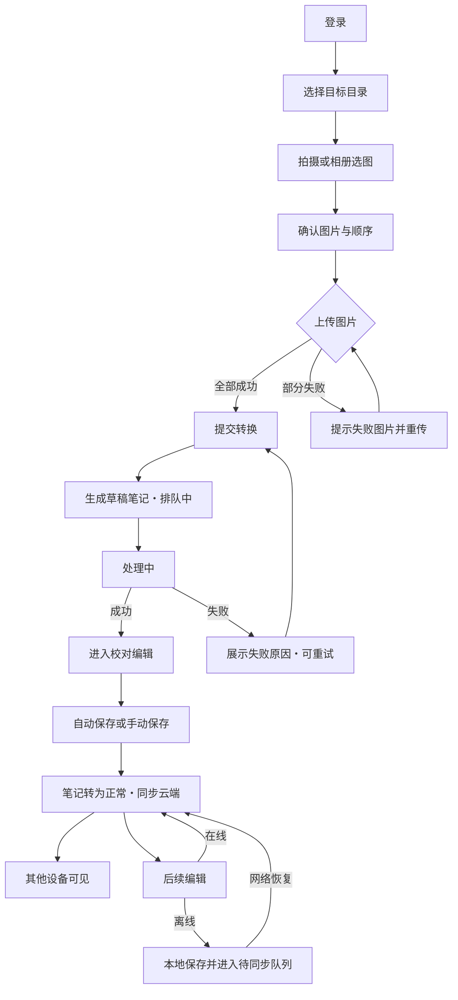

# 拾页笔记（GleanNote）产品需求文档

## 0. 文档信息

| 项目 | 内容 |
|---|---|
| 产品名称 | 拾页笔记（GleanNote） |
| 文档版本 | v1.2 |
| 更新日期 | 2026-10-23 |
| 目标读者 | 产品、设计、Android 客户端、Go 服务端 |
| 平台范围 | Android（本期不含 iOS 与 Web） |
| 已确认技术背景 | 客户端 Kotlin + Jetpack Compose；服务端 Gin（Go）+ 阿里云 ECS（2C4G，Rocky Linux）；图片转 Markdown 由多模态 AI 接口完成。以上为既定背景，本文档只定义产品行为，不约束实现方式。 |

### 0.1 术语表

| 术语 | 定义 |
|---|---|
| 笔记库 | 用户全部笔记的集合，是应用的一级容器。 |
| 目录 | 可嵌套的文件夹，用于组织笔记；根级目录即第 1 层。 |
| 笔记 | 一篇 Markdown 文档，归属唯一目录，可含若干页面图片。 |
| 页面图片 | 用户拍摄或从相册选择的单张原始图片，是笔记的来源材料。 |
| 转换任务 | 一次「页面图片 → Markdown」的 AI 处理请求。 |
| 草稿笔记 | 已提交转换但正文尚未定稿的笔记，在列表中可见并带状态标签。 |
| 原文视图 | 在笔记内查看其页面图片的模式。 |
| 回收站 | 存放已删除目录与笔记、可恢复的容器。 |

### 0.2 标记约定

- `[Assumption]`：为继续推进而先行采用的实现口径或细节取值，产品主决策已确认，可后续微调。

## 1. 背景与目标

### 1.1 问题

纸质材料（教材、讲义、手写笔记、打印资料）在阅读后难以检索、携带与二次利用。用户目前有三种替代方式，各自都有明显缺口：

- 扫描类工具：产出图片或 PDF，内容不可编辑、不可结构化复用；
- 通用笔记工具：录入依赖手动输入，把纸面内容搬进 App 的成本过高；
- 拍照存相册：图片散落在相册中，无目录组织、无跨设备同步。

### 1.2 目标用户与关键时刻

目标用户是需要在纸面材料与电子笔记之间搬运内容的学习者：备考学生、职场自学者、研究人员。

关键时刻：用户刚读完一段纸质材料，希望「现在就把这几页变成能编辑、能检索、能带走的笔记」。此时用户愿意付出的是拍照与少量校对，不愿意付出的是逐字录入与格式排版。

### 1.3 产品决策

以「拍完即得可编辑 Markdown」为核心承诺：识图、结构化、生成 Markdown 由 AI 完成，用户只做校对。产品不追求替代通用笔记工具的全能编辑能力，而是把「纸面 → 可编辑文本」这一段的损耗降到最低。

### 1.4 可观察结果

不使用未经验证的量化指标，以可观察行为描述目标：

- 用户从选图到拿到可编辑 Markdown 笔记，全程不离开应用，不需要借助其他工具转格式；
- 转换失败时，用户可在原草稿上重试，无需重新拍照或重新上传；
- 用户在同一账号的任意 Android 设备登录后，能看到相同的目录结构与笔记内容；
- 用户误删笔记后，可在回收站内自行恢复，无需联系支持。

## 2. 范围

### 2.1 P0 闭环

本期必须完整可用的一条链路：

1. 注册、登录、退出登录；
2. 创建目录与子目录、重命名、移动、删除；
3. 相机拍摄或相册多选页面图片；
4. 上传图片并提交 AI 转换，查看转换进度；
5. 转换结果校对与编辑，手动保存与自动保存；
6. 笔记列表浏览、打开、移动、删除；
7. 多设备云端同步；
8. 回收站恢复与彻底删除。

### 2.2 P0 恢复路径

闭环必须包含以下恢复能力，否则视为未完成：

- 转换失败后原地重试，复用已上传图片；
- 上传中断后仅重传失败图片，不必重新选图；
- 断网时可阅读与编辑已缓存笔记，联网后自动同步；
- 误删目录或笔记后可从回收站恢复；
- 应用被系统回收后，未提交的编辑内容可恢复。

### 2.3 P1 功能范围

P1 为后续迭代交付范围，产品规则与 P0 同等完整，见第 4 章 FR-12 至 FR-18：

1. 全文搜索；
2. 标签；
3. 导出 Markdown 与 PDF；
4. 分享链接与公开分享；
5. 版本历史；
6. 批量导入；
7. 向已有笔记追加页面图片。

后续的分享链接是产品中唯一的纯阅读形态，应用内笔记页不设只读模式。

### 2.4 明确不做

多人协作、评论、权限共享、iOS 与 Web 客户端、本地离线 OCR、OCR 原文对照、付费与会员体系（全部用户使用同一额度与存储上限）。

## 3. 产品模型与核心流程

### 3.1 角色与权限

本期只有「笔记所有者」一种角色。所有者对自己账号下的全部目录、笔记、页面图片拥有查看、创建、编辑、移动、删除、恢复的全部权限；不同账号之间数据完全隔离，不可互相访问。未登录用户只能访问登录页，不可查看任何笔记内容。

### 3.2 对象模型

| 对象 | 从属关系 | 关键属性 | 说明 |
|---|---|---|---|
| 用户 | 顶层 | 邮箱、密码凭证、昵称、注册时间 | 数据的唯一归属者 |
| 目录 | 属于用户，可自嵌套 | 名称、父目录、层级、排序 | 最多 5 层，同一父级下名称唯一 |
| 笔记 | 属于用户与唯一目录 | 标题、正文、状态、更新时间 | 正文为 Markdown 纯文本 |
| 页面图片 | 属于笔记 | 顺序、原图、缩略图 | 保留原始图片，供原文视图与重试使用 |
| 转换任务 | 属于笔记，一对一 | 状态、进度、失败原因、提交时间 | 只保留最近一次，不提供历史记录 |
| 标签 | 属于用户，与笔记多对多 | 名称、关联笔记数 | 账号内共享，多个笔记可复用同一标签 |
| 笔记版本 | 属于笔记 | 时间、来源、正文快照、字数 | 保留最近 50 个且不超过 90 天 |
| 分享链接 | 属于笔记，一对一 | 链接标识、开启状态 | 开启后对外只读，关闭后立即失效 |

### 3.3 状态定义与迁移

**笔记状态**

| 状态 | 含义 | 进入条件 | 允许操作 | 离开路径 |
|---|---|---|---|---|
| 草稿 | 已提交转换但正文未定稿 | 用户提交转换时创建 | 查看进度、取消转换、失败后重试 | 转换成功 → 正常；用户删除 → 已删除 |
| 正常 | 正文已生成且可编辑 | 转换成功并完成首次保存 | 编辑、移动、重命名、删除、查看原文 | 用户删除 → 已删除 |
| 已删除 | 位于回收站 | 用户删除笔记或其所属目录 | 恢复、彻底删除 | 恢复 → 正常；彻底删除或到期 → 彻底删除 |
| 彻底删除 | 数据不可恢复 | 用户确认彻底删除，或保留期到期 | 无 | — |

**转换任务状态**

| 状态 | 含义 | 允许操作 | 进入下一状态的条件 |
|---|---|---|---|
| 排队中 | 已提交，等待处理 | 取消 | 开始处理 → 处理中；用户取消 → 已取消 |
| 处理中 | AI 正在识别与生成 | 取消 | 完成 → 成功；异常或超时 → 失败；用户取消 → 已取消 |
| 成功 | 已生成 Markdown 正文 | 进入校对编辑 | — |
| 失败 | 未能生成可用正文 | 重试 | 重试发起新任务 → 排队中 |
| 已取消 | 用户主动取消 | 重新转换 | 重试发起新任务 → 排队中 |

重试不产生新的笔记，始终作用于原草稿笔记；任务本身只保留最近一次，不向用户展示历史任务列表。

### 3.4 核心流程

分支说明：

- 上传阶段取消：不创建笔记，本次选择的图片全部丢弃，用户需重新选图。
- 转换阶段取消：草稿笔记保留为「已取消」，可随时重新转换。
- 离线：不可发起新转换，但可阅读、编辑、新建空白笔记与目录；联网后按第 5.5 节规则同步。

### 3.5 关键产品决策

1. 一篇笔记对应一次转换任务；向已有笔记追加图片作为独立任务处理，规则见 FR-18。
2. 提交转换即创建草稿笔记，草稿在列表中可见并带状态标签，避免用户在转换期间失去上下文。
3. 页面图片在转换成功后永久保留，作为原文视图与重试的依据，不因正文生成而删除。
4. 转换失败、取消或超时后自动返还已扣减的额度。
5. 目录树与笔记均采用软删除，统一进入回收站，保留 30 天。
6. 每个账号的云端存储上限为 200MB，按页面图片原图占用计算。
7. 分享页是产品内唯一的纯阅读形态，只呈现被分享的单篇笔记，不暴露目录与其他笔记。
8. 单次提交（新建转换或追加页面）最多 20 张，单笔记累计页面图片上限 50 张。

## 4. 功能需求

以下每个模块均按「目的 → 界面区域 → 触发 → 处理规则 → 结果与状态变化 → 异常与恢复」描述。跨模块复用的规则引用第 5 节，不在此重复定义。

---

### FR-01 账号与登录

**目的**：建立账号与数据归属，保证笔记在多设备间属于同一个人。

**界面区域**：启动页、登录页（邮箱输入、密码输入、登录按钮、注册入口、忘记密码入口、协议勾选）、注册页、找回密码页、设置页内的账号区。

**触发**：首次启动、登录态失效、用户主动退出后再次进入。

**处理规则**：

- 本期仅支持邮箱账号，不提供手机号与第三方登录，后续如需扩展不影响既有账号数据。
- 注册使用邮箱 + 密码 + 邮箱验证码。密码长度 8–32 位，必须同时包含字母与数字，不允许纯数字或纯字母。
- 邮箱验证码为 6 位数字，有效期 10 分钟，同一邮箱 60 秒内只能获取一次，连续输错 5 次后本次验证码失效。
- 邮箱格式不合法、已被注册时，注册按钮不可用并给出对应提示。
- 登录使用邮箱 + 密码。连续输错密码 5 次后，该邮箱暂停登录 15 分钟 `[Assumption]`，期间可通过找回密码重置。
- 找回密码通过邮箱验证码完成，重置后原有登录态失效，需重新登录。
- 注册成功后自动创建根级目录「我的笔记」，并直接进入笔记库首页。
- 首次登录或注册必须勾选同意用户协议与隐私政策，未勾选时提交按钮不可用。
- 登录态长期保持，用户再次打开应用无需重复登录，除非主动退出、密码被重置或登录态失效。
- 退出登录需二次确认。退出时清除本机登录态与该账号的本地笔记缓存；存在未同步内容时，先提示「有内容尚未同步，退出后将丢失」，用户确认后才执行。
- 账号注销入口位于设置页，需输入邮箱验证码并二次确认。注销立即生效，账号与全部笔记不可恢复 `[Assumption]`，注销后同一邮箱可重新注册，视为全新账号。

**结果与状态变化**：登录或注册成功后进入笔记库首页；退出或注销后回到登录页，本地不留存该账号数据。

**异常与恢复**：

- 验证码发送失败：提示「验证码发送失败，请稍后重试」，按钮恢复可点击。
- 验证码错误或过期：保留邮箱输入，清空验证码，提示具体原因。
- 邮箱已注册：提示「该邮箱已注册，请直接登录」，并提供跳转登录入口。
- 邮箱未注册：登录时提示「该邮箱尚未注册」，并提供跳转注册入口。
- 密码错误：提示「邮箱或密码不正确」，不区分具体错误项。
- 网络异常：登录请求失败时停留在当前页并提示，不清空已输入内容。
- 登录态失效：任意页面遇到失效时跳转登录页，登录成功后回到原页面。

---

### FR-02 目录管理

**目的**：让用户以接近商业笔记软件的层级结构组织纸面材料，支持长期积累后的分类查找。

**界面区域**：笔记库首页左侧或抽屉中的目录树、顶部面包屑、目录「更多」菜单、新建/重命名弹窗、移动目标选择器。

**触发**：点击「新建目录」、长按目录或点击「更多」、拖拽目录。

**处理规则**：

- 新建目录时需指定父级：根级新建，或在某目录下「新建子目录」。
- 层级上限 5 层，第 1 层为根级目录。处于第 5 层的目录不再显示「新建子目录」，点击时提示「最多支持 5 层目录」。
- 目录名称必填，长度 1–50 个字符，规则见 5.1；同一父级下不允许重名。
- 重命名不改变层级与内容；重命名后该目录下笔记的路径展示同步更新。
- 移动支持两种方式：目录树内拖拽、通过「移动到」选择器选择目标目录。目标可以是根级或其他目录。
- 不允许把目录移动到自身或其子孙目录下；此类目标在选择器中置灰并标注「不可选择」。
- 删除目录为软删除：该目录及其全部子目录、笔记整体进入回收站，并合并为一条删除记录。删除前必须二次确认，提示文案需包含受影响的子目录数与笔记数。
- 默认目录「我的笔记」与普通根级目录行为一致，可重命名、可移动、可删除；删除后若根级为空，展示空态与新建入口。

**结果与状态变化**：目录树即时更新；删除后目录与其中笔记从列表消失，在回收站可见；移动后子目录与笔记整体跟随。

**异常与恢复**：

- 名称重复：输入框下方提示「当前目录下已存在同名目录」，保存按钮不可用。
- 名称超长或含非法字符：提示具体规则，保存按钮不可用。
- 层级超限：禁止创建子目录，并提示层级上限。
- 删除失败（网络异常）：目录保留在原位并提示重试，不进入回收站。
- 空目录：目录树正常展示，进入后笔记列表展示空态。

---

### FR-03 取图

**目的**：以最低操作成本获得清晰的纸面图片，是整条链路的起点。

**界面区域**：目录内的新建入口、拍摄界面（取景框、快门、已拍缩略图条）、相册多选界面、待转换确认页（图片缩略图、排序、删除、目标目录、开始转换按钮）。

**触发**：用户在某个目录内点击「拍照创建」或「从相册选择」。

**处理规则**：

- 提供两个入口：拍摄、从相册选择。相册通过系统照片选择器完成，用户仅选择照片，不授予整个相册的访问权限。
- 拍摄界面支持连续拍摄，每拍一张即加入底部缩略图条；可对单张执行重拍或删除；可点击缩略图查看大图并左右滑动检查清晰度。
- 单次转换最多 20 张图片。达到上限后快门与选择入口置灰，并提示「单次最多 20 张」。
- 支持 JPG、PNG、HEIC、WEBP；选择器中的非图片文件不可选。HEIC 等格式在本地统一转为 JPEG 后上传，用户无感知。
- 单张图片大于 10MB 时不阻断，由客户端压缩后再上传，压缩规则见 5.2。
- 图片顺序即笔记中内容的先后顺序。确认页支持拖拽调整顺序，调整结果在缩略图条上即时可见。
- 确认页可选择目标目录，默认取当前所在目录；允许切换。
- 确认页展示本次提交的图片张数与今日剩余额度。剩余额度小于本次张数时，「开始转换」不可用，并提示剩余张数与减少图片的入口。
- 提交前校验云端存储剩余空间：本次图片预计占用超过剩余容量时阻止提交，提示前往回收站或删除笔记释放空间。
- 点击「开始转换」进入上传流程；未选任何图片、额度不足或空间不足时按钮不可用。

**结果与状态变化**：确认后页面进入上传阶段；返回或取消时，若已有图片则提示「放弃本次选择的 N 张图片？」，确认后清空本次选择。

**异常与恢复**：

- 相机权限被拒：展示说明页，提供「去设置开启」按钮，返回应用后重新检测权限。
- 相册访问被拒：提示改用系统照片选择器或前往设置开启。
- 拍摄中应用被切后台或来电：中断当前拍摄，已拍摄的图片保留在缩略图条。
- 本地存储空间不足：拍摄或选择时提示清理空间，不进入后续流程。
- 图片损坏无法读取：在缩略图上标记「无法读取」，提供删除，其他图片不受影响。

---

### FR-04 图片上传与预处理

**目的**：把页面图片可靠地送达服务端，并控制流量与等待时间。

**界面区域**：待转换确认页内的上传进度区、失败图片列表、重试按钮。

**触发**：用户点击「开始转换」。

**处理规则**：

- 上传前统一处理：去除图片位置等元数据，等比压缩至长边不超过 1600px，输出 JPEG 质量 85。压缩后仍保留原始图片的本地副本用于原文视图 `[Assumption]`。
- 上传按用户设定顺序进行，最多同时上传 2 张，其余排队。
- 展示整体进度：已完成张数 / 总张数，以及百分比进度条。
- 全部图片上传成功后立即提交转换任务；任意一张未成功则不提交，避免残缺内容进入识别。
- 上传过程中可取消。取消后不创建笔记，已上传的图片不进入用户数据，用户需重新选图。
- 同一批图片在提交中不允许重复点击「开始转换」，按钮进入加载态。

**结果与状态变化**：提交成功后创建草稿笔记并跳转转换进度页；取消后回到确认页或上一页。

**异常与恢复**：

- 单张失败：自动重试 1 次；仍失败则在失败列表中列出该图片，提供「重传失败图片」，仅重传失败项，已成功项不重复上传。
- 断网：暂停上传，提示「网络已断开，恢复后自动继续」；网络恢复后自动续传 `[Assumption]`。
- 弱网：展示预计等待提示，允许用户取消。
- 上传超时：按失败处理并进入重传流程。
- 应用被切后台：上传继续；进程被系统回收后，重新进入应用可恢复到该草稿的上传或转换状态 `[Assumption]`。

---

### FR-05 AI 转换

**目的**：把页面图片转成结构化的、可编辑的 Markdown，是产品的核心价值环节。

**界面区域**：转换进度页（阶段文案、进度指示、取消按钮）、失败结果页（失败原因、重试按钮）、转换完成后的校对编辑页。

**触发**：图片上传全部成功并自动提交。

**处理规则**：

- 转换以异步任务执行，同一用户同时最多 1 个任务处于「处理中」，其余任务为「排队中」。
- 进度页按阶段展示文案：排队中、正在识别第 N/M 页、正在生成 Markdown、已完成。无法给出精确百分比时使用不确定进度动画。
- 单任务超过 5 分钟未完成判定为失败 `[Assumption]`，提示用户重试。
- 转换结果生成 Markdown 正文，保留标题层级、列表、表格、加粗、引用等结构；无法识别的页面在正文对应位置插入「（第 N 页未识别到文字）」占位，并在结果页提示未识别页数。
- 笔记标题默认取正文第一个标题；若正文没有标题，使用「未命名笔记 + 提交时间」`[Assumption]`。
- 转换成功后自动完成一次保存，笔记状态由「草稿」变为「正常」。
- 转换成功默认进入编辑页，用户可直接校对，笔记不区分「阅读模式」与「编辑模式」。
- 额度与云端存储规则见 5.3 与 5.3.1；额度不足或空间不足时不允许提交，已有草稿的重试同样受限。
- 排队中与处理中均允许取消。取消后草稿笔记保留，转换任务状态为「已取消」，用户可重新发起转换。
- 重试复用已上传的页面图片，不要求用户重新选图。

**结果与状态变化**：成功 → 草稿转正常，列表中的状态标签更新；失败 → 草稿保留，标签为「转换失败」；取消 → 草稿保留，任务为「已取消」，笔记标签为「已取消」。三种情况均不删除页面图片。

**异常与恢复**：

| 失败类型 | 判定依据 | 提示文案要点 | 可否重试 |
|---|---|---|---|
| 网络中断 | 提交或查询过程中断网 | 网络异常，请检查网络 | 可重试 |
| 图片无法识别 | 图片模糊、反光、非文字内容 | 部分页面不清晰，建议重拍后重试 | 可重试，可选择返回重新拍摄 |
| 服务繁忙 | 服务端返回繁忙或无响应 | 当前使用人数较多，请稍后重试 | 可重试 |
| 内容不支持 | 图片主体非可转换内容 | 该内容暂不支持转换 | 可重试，建议更换图片 |
| 额度不足 | 今日剩余张数小于本次提交张数 | 今日额度剩余 N 张，可减少图片后重试 | 减少图片后可重试 |
| 存储空间不足 | 云端已用容量加本次图片将超过 200MB | 云端空间不足，请清理后重试 | 清理后可重试 |

- 应用在后台时转换完成：发送系统通知，用户点击后进入对应笔记 `[Assumption]`。
- 转换完成但正文为空：按失败处理，提示「未能识别到可用的文字内容」。

---

### FR-06 笔记编辑与校对

**目的**：让用户以最低成本修正 AI 识别误差，并把笔记整理成自己可用的形态。

**界面区域**：笔记页（顶部标题、预览/编辑切换、正文区、底部工具栏、保存状态指示、原文视图入口）。

**触发**：转换成功后自动进入；或在列表中点击状态为「正常」的笔记。

**处理规则**：

- 笔记页不区分阅读与编辑：预览与编辑是同一页面内的视图切换，不存在独立阅读页，也不存在只读状态（分享链接除外）。
- 打开笔记默认展示预览视图；转换完成后首次进入默认展示编辑视图，便于立即校对。
- 正文为 Markdown 纯文本，编辑视图提供轻量语法高亮：标题、加粗、斜体、列表、引用、代码块。
- 底部工具栏提供：标题层级（H1–H3）、加粗、斜体、无序列表、有序列表、待办、引用、代码块、分割线、撤销、重做。表格通过手写 Markdown 或预览确认，不提供表格插入器 `[Assumption]`。
- 顶部提供「编辑 / 预览」切换，同一时刻只展示一种形态。
- 保存规则：
  - 用户停止输入 2 秒后自动保存到本地，联网时随后同步到云端；
  - 提供手动保存入口；
  - 离开页面时自动保存，不弹保存确认；
  - 保存状态以「已保存 / 保存中 / 未保存」在顶部展示。
- 标题在顶部独立编辑，长度规则见 5.1。标题为空时保存后显示为「未命名笔记」。
- 正文上限 20 万字符，达到上限后禁止继续输入并提示。
- 编辑不改变笔记所属目录；调整位置通过「移动到」完成。

**结果与状态变化**：内容保存后笔记更新时间刷新，列表排序随之变化；笔记状态保持「正常」。

**异常与恢复**：

- 自动保存失败：顶部显示「未保存」并提供重试，不阻塞继续编辑。
- 离线编辑：本地保存成功，标识「待同步」；联网后自动同步，用户无需手动操作。
- 编辑过程中应用被回收：重新进入笔记时恢复至最后一次本地保存的内容，并提示「已恢复未同步的编辑内容」。
- 正文超限：在输入位置提示已达上限，已输入内容不丢失。
- 多设备同时编辑同一笔记：按 5.5 节冲突规则处理，不静默丢弃任何一方内容。

---

### FR-07 笔记列表与浏览

**目的**：让用户在目录内快速定位到某篇笔记，并感知草稿与失败状态。

**界面区域**：笔记库首页（顶部当前目录与面包屑、笔记列表、排序入口、右下角新建入口）、侧边或抽屉内的目录树。

**触发**：进入应用、切换目录、下拉刷新。

**处理规则**：

- 列表展示当前目录下的笔记，不混入子目录内容；子目录通过目录树进入。
- 笔记卡片展示：标题、更新时间、首张页面图片缩略图、状态标签（草稿 / 转换失败 / 已取消 / 待同步）。状态为「正常」且已同步时不展示标签。
- 默认按更新时间倒序；可切换为按创建时间倒序、按标题排序 `[Assumption]`。排序选择在本次会话内保持。
- 列表分页加载，每页 20 条，滚动到底部自动加载下一页 `[Assumption]`。
- 点击草稿、失败或已取消的笔记，进入对应的进度页或失败页，而不是笔记页。
- 长按笔记或点击「更多」提供：重命名、移动到、删除。
- 顶部提供回收站入口 `[Assumption]`，也可从设置进入。

**结果与状态变化**：新建、删除、移动、转换完成后列表即时更新；切换目录时列表整体替换。

**异常与恢复**：

- 空目录：展示空态插画与「拍摄第一页纸质材料」按钮。
- 首次加载：展示骨架屏，不展示空白页。
- 加载失败：展示错误态与「重试」按钮，保留顶部目录信息。
- 刷新失败：保留已有内容，顶部提示「同步失败，点击重试」。
- 离线：展示本地缓存内容，顶部展示「离线模式」标识 `[Assumption]`。

---

### FR-08 笔记页预览与原文视图

**目的**：在同一个笔记页内提供舒适的预览呈现，并让用户随时核对 AI 识别结果与原始纸张内容。

**界面区域**：笔记页预览视图（渲染正文、顶部切换、更多操作）、原文视图（页面图片浏览、页码指示、缩放）、图片全屏查看。

**触发**：在列表中点击状态为「正常」的笔记；或在笔记页切换到预览视图、点击「原文」。

**处理规则**：

- 预览渲染范围：标题、段落、加粗、斜体、无序/有序列表、待办、引用、代码块、表格、分割线、图片、链接、公式 `[Assumption]`。
- 正文中的图片在预览时渲染为图片，点击进入原文视图并定位到该图片对应的页面。
- 原文视图按用户选定的图片顺序展示，支持左右滑动切换页面、双指缩放、双击放大、页码指示（第 N / M 页）。
- 更多操作：重命名、移动到、删除、复制 Markdown 全文到剪贴板 `[Assumption]`。
- 链接点击后在系统浏览器打开，应用内不内嵌网页。
- 超长笔记首屏优先渲染，向下滚动渐进加载，不出现长时间白屏。

**结果与状态变化**：预览与原图浏览不改变笔记内容；重命名、移动、删除后返回列表并同步更新。

**异常与恢复**：

- 笔记加载失败：展示错误态与「重试」，可返回列表。
- 预览中图片加载失败：展示占位图与「重试加载」，不影响正文其他部分。
- 原文图片缺失：该页显示「图片不可用」，其余页面正常浏览。
- 笔记已在其他设备被删除：展示「该笔记已被删除」，提供返回列表与前往回收站查看。

---

### FR-09 删除与回收站

**目的**：降低误删成本，让删除成为可逆操作。

**界面区域**：删除确认弹窗、回收站列表（项目类型、名称、原路径、剩余天数、恢复、彻底删除）、彻底删除确认弹窗。

**触发**：在笔记或目录的「更多」中选择删除；进入回收站。

**处理规则**：

- 删除笔记：二次确认后进入回收站，笔记状态转为「已删除」。
- 删除目录：二次确认，提示包含「N 个子目录、M 篇笔记」，确认后整棵子树进入回收站并合并为一条记录。
- 删除不立即清除页面图片与正文，回收站内可恢复。
- 回收站按删除时间倒序展示，每条展示类型（目录 / 笔记）、名称、原所在路径、剩余保留天数。
- 保留期 30 天。到期后系统自动彻底删除，用户无感知、不另行通知。
- 恢复：
  - 笔记恢复至原目录；原目录仍在回收站时，恢复操作同时恢复其必要的上级目录 `[Assumption]`。
  - 原目录已被彻底删除时，恢复到根级目录，并提示「原目录已删除，已恢复到根目录」。
  - 目录恢复时，其子树内所有子目录与笔记一并恢复。
- 彻底删除：二次确认，文案明确「彻底删除后无法恢复」，确认后立即清除正文与页面图片。
- 回收站内支持单条操作，本期不提供批量恢复与批量彻底删除。

**结果与状态变化**：删除后项目从笔记列表与目录树移除；恢复后回到原位置并重新出现在列表中；彻底删除后从回收站消失且不可再访问。

**异常与恢复**：

- 回收站为空：展示空态「回收站是空的」。
- 恢复时原父目录下已存在同名目录：恢复的目录名称追加序号，变为「原名 (2)」，不覆盖已有目录。
- 恢复失败（网络异常）：项目保留在回收站并提示重试。
- 到期清理与用户手动恢复同时发生：以服务端最终状态为准，客户端刷新后展示实际结果。

---

### FR-10 云端同步

**目的**：保证同一账号在多设备上看到一致的目录与笔记，并支持弱网与离线使用。

**界面区域**：笔记列表顶部的同步状态提示、设置页的同步状态与手动同步入口、冲突副本提示。

**触发**：登录成功后、应用回到前台、网络恢复、笔记保存后、用户下拉刷新、用户手动同步。

**处理规则**：

- 同步范围：目录结构、笔记元数据（标题、所属目录、更新时间、状态）、笔记正文、页面图片的可用性。列表仅加载缩略图，打开笔记或原文视图时才加载原图 `[Assumption]`。
- 多设备以服务端为最终依据，客户端保留本地缓存用于离线展示。
- 离线能力：
  - 可阅读已缓存的目录与笔记；
  - 可编辑已缓存笔记；
  - 可新建目录与空白笔记；
  - 不可发起 AI 转换，入口置灰并提示「需要联网」。
- 离线产生的变更进入本地待同步队列，联网后按变更发生顺序提交。
- 冲突判定：同一笔记在两台设备上分别离线编辑，后同步的一方提交时，以最后提交的内容为准，先提交的内容另存为副本笔记，标题为「原标题（冲突副本 时间）」`[Assumption]`。
- 冲突副本与普通笔记同等对待，用户可查看、编辑、删除。
- 同步状态展示：同步中、已同步、同步失败（可重试）。同步失败不阻塞本地编辑。

**结果与状态变化**：同步完成后列表与目录树刷新；产生冲突副本时，在列表顶部提示「检测到编辑冲突，已保留副本」。

**异常与恢复**：

- 同步失败：保留本地内容，展示失败提示与重试入口；不出现内容回退。
- 服务端内容被其他设备删除：本地刷新后移除该项，若用户正在查看则提示「该笔记已被删除」。
- 本地缓存被清理：未同步内容必须先提示，用户确认后才清理；清理后重新从云端拉取。
- 登录态失效：暂停同步并跳转登录页，登录成功后继续同步。

---

### FR-11 设置

**目的**：集中放置账号、存储、额度与协议相关操作。

**界面区域**：设置页（账号区、存储区、额度区、通知区、回收站入口、关于区）。

**触发**：从笔记库进入设置。

**处理规则**：

- 账号区：展示昵称与脱敏邮箱，支持修改昵称 `[Assumption]`、找回密码、退出登录、注销账号。
- 存储区：展示本地缓存占用（含页面图片），提供「清理缓存」；清理前提示未同步内容的影响，确认后执行。
- 存储区同时展示云端存储用量：已用容量 / 200MB，以进度条呈现，计算口径与上限行为见 5.3.1。
- 额度区：展示今日剩余可转换张数与重置时间（次日 0 点）。
- 通知区：转换完成通知开关，默认开启 `[Assumption]`；关闭后不再发送系统通知。
- 回收站入口：进入 FR-09 的回收站。
- 关于区：版本号、用户协议、隐私政策、意见反馈入口。

**结果与状态变化**：设置项修改后即时生效并本地保存；退出登录与注销按 FR-01 规则执行。

**异常与恢复**：

- 清理缓存失败：保留原缓存并提示重试。
- 版本信息获取失败：展示本地版本号，不影响其他功能。

---

### FR-12 全文搜索

**目的**：在笔记数量增长后，让用户不依赖记忆中的目录位置找到内容。

**界面区域**：笔记库首页顶部搜索入口、搜索页（关键词输入、搜索历史、目录与标签筛选、结果列表）。

**触发**：点击搜索入口；输入至少 1 个字符并停止输入 300ms 后自动搜索；点击搜索历史项。

**处理规则**：

- 搜索范围为当前账号下状态为「正常」的全部笔记，匹配标题与正文；草稿、回收站内容不参与搜索。
- 中文按连续字符匹配，英文不区分大小写；关键词最长 100 字符，超出部分不参与匹配。
- 排序规则：标题命中优先于正文命中；同一层级按更新时间倒序。
- 结果展示标题、命中片段（关键词高亮，前后各保留约 20 字）、所属目录路径与更新时间。
- 支持按目录筛选，筛选目录时包含其全部子目录；支持与标签筛选叠加，标签多选时要求同时包含。
- 点击结果打开笔记页，并定位到正文中第一次出现关键词的位置 `[Assumption]`。
- 搜索历史保留最近 10 条，支持单条删除与一键清空。
- 离线时仅搜索本地已缓存笔记，并在顶部提示「离线模式，仅搜索已缓存内容」。

**结果与状态变化**：搜索不修改任何笔记内容；筛选条件在离开搜索页后清除。

**异常与恢复**：

- 无结果：展示「没有找到相关笔记」与清除筛选入口。
- 搜索失败：展示错误态与「重试」，保留已输入关键词。
- 结果中的笔记已被删除：点击后提示「该笔记已被删除」，返回结果列表。

---

### FR-13 标签

**目的**：提供跨目录的主题归类方式，弥补单一目录树无法表达多维分类的问题。

**界面区域**：笔记页顶部标签区、笔记库侧栏「标签」入口、标签筛选列表、设置页内的标签管理页。

**触发**：在笔记页点击「添加标签」；在侧栏点击某个标签；进入标签管理。

**处理规则**：

- 标签归属于账号，可在多篇笔记间复用；给笔记添加标签时输入即联想已有标签，选择即复用，输入不存在的名称则新建。
- 每个标签名称 1–20 个字符，不允许首尾空格；同一账号内标签名称唯一，名称相同时视为同一标签。
- 每篇笔记最多 10 个标签，超出时禁止继续添加并提示。
- 笔记页的标签可单个移除；移除只解除该笔记的关联，不删除标签本身。
- 标签管理页按关联笔记数倒序展示全部标签，支持重命名与删除。
- 重命名标签后，所有关联笔记同步显示新名称。
- 删除标签需二次确认，提示关联的笔记数量；删除后从全部笔记移除该标签，笔记本身不受影响。
- 在侧栏点击标签进入筛选结果，列表仅展示包含该标签的笔记；多选标签时取同时包含的交集。
- 标签随笔记参与云端同步，离线状态下可添加或移除，联网后同步。

**结果与状态变化**：添加、移除、重命名、删除标签后，相关笔记的标签展示与筛选结果即时更新。

**异常与恢复**：

- 标签数量超限：提示「每篇笔记最多 10 个标签」。
- 名称超长或含首尾空格：输入框内提示并禁止保存。
- 标签已被其他设备删除：同步后自动从笔记移除，并在笔记页提示「部分标签已失效」。
- 离线操作失败：保留本地变更并进入待同步队列。

---

### FR-14 导出 Markdown 与 PDF

**目的**：让用户把笔记带出应用，用于备份、打印或交付给其他工具。

**界面区域**：笔记页更多菜单中的「导出」、目录更多菜单中的「导出目录」、导出格式选择、系统文件保存器、导出进度提示。

**触发**：用户选择导出笔记或导出目录。

**处理规则**：

- 单篇导出 Markdown：生成 `.md` 文件，图片与文件一并打包为 zip，包内包含 `images` 目录，Markdown 中的图片引用改为包内相对路径。
- 单篇导出 PDF：A4 版式，保留标题、段落、列表、待办、引用、代码块、表格、图片与公式的渲染效果；只包含笔记内容，不包含应用界面元素。
- 目录导出：生成 zip，内部保留子目录层级；每篇笔记一个 `.md` 文件，图片按笔记分别放入对应 `images` 目录；空目录保留为空文件夹。
- 文件名使用笔记标题，非法字符替换为下划线，同名文件自动追加序号。
- 仅状态为「正常」的笔记可导出；草稿需完成转换后才能导出。
- 导出通过系统文件保存器选择保存位置，完成后提示保存路径。
- 导出不消耗转换额度，不受 200MB 云端容量限制。
- 目录导出展示整体进度（已处理篇数 / 总篇数），支持取消，取消后已生成的部分不保留。

**结果与状态变化**：导出不修改笔记内容与更新时间；导出记录不写入版本历史。

**异常与恢复**：

- 本地空间不足：导出前提示所需空间，空间不足时禁止开始。
- 导出中断：提示失败原因，可重新导出。
- 离线导出：图片均已缓存时可导出 Markdown；PDF 或目录导出需要全部图片可用，缺图时提示联网后重试或取消。
- 目录内包含大量笔记：导出过程可切后台继续，完成后发送通知 `[Assumption]`。

---

### FR-15 分享链接与公开分享

**目的**：让用户把单篇笔记以只读形式发给他人，而不暴露自己的目录结构与其他内容。

**界面区域**：笔记页更多菜单中的「分享」、分享设置面板（开启开关、链接、复制、系统分享、关闭分享）、浏览器中的分享页。

**触发**：用户在笔记页选择「分享」；访问他人发来的分享链接。

**处理规则**：

- 每篇笔记最多一个分享链接。首次开启时二次确认，说明「开启后任何获得链接的人都可以查看本篇内容与页面图片」。
- 分享页为纯阅读页面，仅展示笔记标题、正文与页面图片；不展示目录路径、标签、其他笔记、编辑入口与账号信息。
- 分享页内容始终与被分享笔记的最新内容一致；笔记编辑并同步后，分享页刷新即可看到最新内容。
- 分享链接可复制到剪贴板，或通过系统分享面板发送。
- 关闭分享立即生效，已打开的链接再次访问时展示「内容已失效」。
- 笔记删除时分享链接的处理见 5.4，恢复后需重新开启分享。
- 分享不消耗转换额度，不计入导出。

**结果与状态变化**：开启后笔记页显示「已分享」标识；关闭后标识消失，链接不可访问。

**异常与恢复**：

- 链接生成失败：提示重试，不改变原有分享状态。
- 访问失效链接：展示失效提示页，不泄露笔记标题与内容。
- 笔记仍为草稿：不允许分享，提示先完成转换。
- 公开内容涉及个人隐私：开启前的确认文案需明确提示内容将对外公开，由用户自行确认。

---

### FR-16 版本历史

**目的**：让用户在误改、误恢复或 AI 追加内容出错后，能够回到之前的正文状态。

**界面区域**：笔记页更多菜单中的「版本历史」、版本列表（时间、来源、字数）、版本预览（只读）、恢复确认弹窗。

**触发**：用户在笔记页打开「版本历史」。

**处理规则**：

- 版本在以下时机生成：转换完成、手动保存、自动保存（同一笔记两次自动版本间隔不少于 5 分钟 `[Assumption]`）、冲突副本生成、从历史版本恢复。
- 每个版本记录生成时间、触发来源与正文字数；不记录标题、标签与所属目录的变化。
- 每个笔记保留最近 50 个版本，且仅保留 90 天内生成的版本 `[Assumption]`，超出部分自动清理。
- 版本列表按时间倒序展示；点击版本进入只读预览，不提供逐行对比 `[Assumption]`。
- 恢复版本需二次确认，确认后以该版本正文替换当前正文，并生成一个新版本记录，不删除任何历史版本。
- 恢复只替换正文，不改变笔记标题、标签与所属目录。
- 笔记彻底删除时，其全部版本一并删除。
- 版本正文不计入 200MB 云端容量。

**结果与状态变化**：恢复后笔记正文与更新时间刷新，列表排序相应变化；版本数量增加一条。

**异常与恢复**：

- 版本列表加载失败：展示错误态与「重试」。
- 版本预览内容缺失：提示该版本不可用，可返回列表。
- 恢复失败：保留当前正文不变，提示重试，不出现内容丢失。
- 多设备同时恢复同一笔记：按 5.5 节冲突规则处理。

---

### FR-17 批量导入

**目的**：支持用户一次性把多页、多份纸质材料导入应用，避免逐篇创建。

**界面区域**：笔记库首页新建菜单中的「批量导入」、图片选择器、导入模式与目标目录设置、导入队列页（逐篇状态、整体进度、取消、重试）。

**触发**：用户选择「批量导入」并完成图片选择。

**处理规则**：

- 从系统选择器一次最多选择 50 张图片 `[Assumption]`，支持 JPG、PNG、HEIC、WEBP，超限时提示并截断到上限。
- 提供两种模式：
  - 每张图片生成一篇笔记（默认）；
  - 按选择顺序合并为一篇笔记，单篇最多 20 张，超出时提示改用逐张模式。
- 导入前选择目标目录，默认取当前所在目录。
- 导入前校验当日剩余额度与云端剩余容量，按可支持的张数限制本次可选图片数量；不足时提示实际可导入张数与原因。
- 导入队列串行处理，每篇独立创建草稿并执行转换，逐篇展示状态；已完成部分不受后续失败影响。
- 可取消尚未开始的任务，已完成与处理中的任务按原状态保留。
- 单篇失败可单独重试，不重新上传该篇已成功的图片。
- 导入过程可切后台继续，全部完成后发送通知 `[Assumption]`。

**结果与状态变化**：导入完成后，每个成功项生成一篇状态为「正常」的笔记并出现在目标目录；失败项以草稿形态保留。

**异常与恢复**：

- 部分图片无法读取：在队列中标记跳过，其余继续导入。
- 额度或空间在导入过程中耗尽：剩余任务转为「失败」，提示原因，已完成项保留。
- 导入中途取消：已完成的笔记保留，未开始的任务移除。
- 应用被系统回收：重新进入后可查看导入结果，未完成项按草稿状态展示。

---

### FR-18 向已有笔记追加页面图片

**目的**：让用户在读完后续书页或补充材料后，把新内容并入同一篇笔记，而不是新建一篇。

**界面区域**：笔记页更多菜单中的「追加页面」、拍摄/相册选择、追加确认页（新增图片缩略图、数量、额度与空间提示）、追加转换进度。

**触发**：用户在状态为「正常」的笔记中选择「追加页面」。

**处理规则**：

- 仅状态为「正常」的笔记可追加；草稿、失败、已取消的笔记需先完成转换。
- 单次追加最多 20 张；笔记累计页面图片上限 50 张 `[Assumption]`，达到上限时禁止追加并提示。
- 新增图片按用户排序追加到原文视图末尾，原有页面图片顺序不变。
- 追加任务只处理新增图片，转换结果追加到当前正文末尾，不覆盖、不重排已有内容。
- 追加期间笔记保持可编辑；转换完成时，结果追加到当时的最新正文末尾。
- 追加不改变笔记标题、标签与所属目录。
- 额度与云端容量规则同 5.3 与 5.3.1，提交前校验。
- 追加失败时已有正文不变，新增图片保留，可原地重试。

**结果与状态变化**：成功后在正文末尾新增内容，原文视图页数增加，笔记更新时间刷新；追加过程不改变笔记的「正常」状态。

**异常与恢复**：

- 达到 50 张上限：禁止追加，提示上限。
- 部分新增页面未识别：在正文追加位置插入「（第 N 页未识别到文字）」占位，并提示未识别页数。
- 追加期间笔记被删除：任务取消，不写入任何内容。
- 追加期间多设备同时编辑：按 5.5 节冲突规则生成冲突副本，不静默覆盖正文。

---

## 5. 共享规则与异常

以下规则被多个模块引用，全文只在此定义一次。

### 5.1 命名与标题

| 对象 | 长度 | 允许字符 | 重名 | 默认值 |
|---|---|---|---|---|
| 目录名称 | 1–50 个字符 | 不允许 `/ \ : * ? " < > \|`，不允许首尾空格 | 同一父级下不可重名 | 新建时为空，必须输入 |
| 笔记标题 | 1–100 个字符 | 不做字符限制 | 同一目录下允许重名 | 为空时显示「未命名笔记」 |

字符计数按实际字符数计算，中文、英文、数字、符号各计 1 个，不计空格以外的不可见字符。

### 5.2 内容与容量限制

| 项目 | 限制 | 超限行为 |
|---|---|---|
| 单次转换图片数 | 20 张 | 禁止继续添加并提示 |
| 单张图片大小 | 10MB | 压缩后上传，不阻断 |
| 上传前压缩 | 长边 ≤ 1600px，JPEG 质量 85 | 自动执行，用户无感知 |
| 支持格式 | JPG、PNG、HEIC、WEBP | 其他格式不可选择 |
| 目录层级 | 5 层 | 禁止创建子目录并提示 |
| 笔记正文 | 20 万字符 | 禁止继续输入并提示 |
| 单笔记页面图片 | 50 张 `[Assumption]` | 达到上限禁止继续追加 |
| 云端存储容量 | 每账号 200MB，按页面图片原图占用计算 | 达到上限禁止提交新转换，删除或清空回收站释放 |

### 5.3 额度规则

- 每日免费额度为 50 张页面图片，在设置页展示今日剩余张数。
- 计数口径：按提交的图片张数扣减，一次提交 12 张即扣 12 张。
- 提交时扣减；失败、取消、超时后自动返还。重试重新扣减，再次失败同样返还。
- 按北京时间每日 0 点重置，未用完的额度不累积到次日。
- 提交前校验剩余额度：剩余张数小于本次提交张数时不允许提交，用户可减少图片张数后重试。
- 额度不足时，已有草稿的重试同样受限；额度恢复后可继续重试。

### 5.3.1 云端存储规则

- 每个账号的云端存储上限为 200MB，按已保存笔记的页面图片原图占用计算，Markdown 正文不计入 `[Assumption]`。
- 回收站中的笔记仍占用配额，彻底删除或到期清理后释放。
- 已用容量达到 90% 时提示「云端空间即将用尽」，达到上限时禁止提交新的转换任务，已有笔记的编辑与阅读不受影响。

### 5.4 删除语义

| 操作 | 影响范围 | 是否可恢复 | 保留期 |
|---|---|---|---|
| 删除笔记 | 笔记正文、页面图片、转换任务 | 可恢复 | 30 天 |
| 删除目录 | 目录、全部子目录、全部笔记 | 整体可恢复 | 30 天 |
| 恢复笔记 | 笔记及其页面图片 | — | — |
| 恢复目录 | 目录及其子树全部内容 | — | — |
| 彻底删除 | 立即清除，不可恢复 | 否 | — |
| 到期自动清理 | 超过 30 天的回收站项目 | 否 | — |

删除是软删除，不改变笔记内容；恢复后笔记的更新时间以恢复时间为准，排序相应变化 `[Assumption]`。笔记进入回收站时，其分享链接立即失效，恢复后需重新开启分享。

### 5.5 同步与冲突

| 场景 | 处理 |
|---|---|
| 单设备在线编辑 | 保存后立即同步，服务端为准 |
| 多设备离线编辑同一笔记 | 后提交者覆盖，先提交内容另存为冲突副本 |
| 多设备同时在线编辑同一笔记 | 以最后保存时间为准，先保存内容另存为冲突副本 |
| 一端删除、一端编辑 | 删除优先，编辑端刷新后提示笔记已被删除，编辑内容不自动恢复 `[Assumption]` |
| 目录移动与笔记编辑并发 | 两者互不影响，分别生效 |
| 同目录下并发创建同名目录 | 后创建者保存失败，提示重名 |

### 5.6 网络与离线行为

| 状态 | 可做什么 | 不可做什么 | 用户可见提示 |
|---|---|---|---|
| 在线 | 全部功能 | — | 无 |
| 弱网 | 阅读缓存、编辑缓存笔记 | 上传与转换可能超时 | 上传进度停滞提示 |
| 断网 | 阅读缓存、编辑缓存、新建目录与空白笔记、搜索已缓存笔记、添加或移除标签 | 发起 AI 转换、登录、开启分享、导出 PDF 或目录 | 顶部「离线模式」标识 |
| 切后台 | 上传与转换继续 | — | 转换完成发送通知 |
| 进程被回收 | 重新进入后恢复未完成的草稿 | 正在上传的临时进度不保留 | 恢复提示 |
| 登录态失效 | 重新登录 | 全部数据操作 | 跳转登录页 |

### 5.7 权限与数据边界

- 所有笔记数据按账号隔离，客户端不提供跨账号查看入口。
- 未登录状态仅可访问登录页与协议页面。
- 退出登录与切换账号时清除上一账号的本地数据，不做跨账号残留。
- 页面图片仅用于当前账号的笔记展示与转换，默认不对外公开。
- 开启分享后，被分享笔记的标题、正文与页面图片对持有链接的人可见；标签、目录路径与其他笔记始终不随分享暴露。
- 关闭分享、删除笔记或笔记所属目录被删除时，分享链接立即失效。

### 5.8 时间与展示

- 所有时间以北京时间（UTC+8）计算，额度重置、回收站保留期均按此口径。
- 列表时间显示规则：1 分钟内为「刚刚」，1 小时内为「N 分钟前」，24 小时内为「N 小时前」，本年内为「M月D日」，跨年为「YYYY年M月D日」。
- 回收站剩余天数按自然日计算，最少显示「今天到期」。

## 6. 关键界面清单

只描述区域职责与关键状态，不做像素级视觉规范。

| 界面 | 区域与职责 | 必须覆盖的状态 |
|---|---|---|
| 启动 / 登录 | 邮箱、密码、登录、注册入口、忘记密码、协议勾选 | 默认、邮箱格式错误、已注册、未注册、验证码倒计时、验证码错误、密码错误、网络失败、协议未勾选 |
| 笔记库首页 | 目录树、标签入口、搜索入口、面包屑、笔记列表、排序、新建入口、回收站入口、同步状态 | 空库、空目录、加载中、加载失败、离线、同步失败 |
| 拍摄 | 取景、快门、缩略图条、完成入口 | 权限被拒、达到 20 张上限、本地存储不足 |
| 相册选择 | 系统照片选择器、已选计数 | 无可选图片、超限提示 |
| 待转换确认 | 缩略图、拖拽排序、删除、目标目录、额度与空间提示、开始转换 | 默认、未选图片、额度不足、云端空间不足、上传中、部分失败 |
| 转换进度 | 阶段文案、进度指示、取消 | 排队中、处理中、成功跳转、失败、已取消 |
| 笔记页 | 标题、标签、编辑/预览切换、正文、工具栏、保存状态、原文入口、更多操作（分享/导出/版本/追加） | 编辑视图、预览视图、保存中、未保存、超限、离线待同步、笔记已删除 |
| 原文视图 | 页面图片、页码、缩放 | 正常、图片缺失 |
| 搜索 | 关键词、搜索历史、目录与标签筛选、结果列表 | 默认、无结果、离线仅缓存、搜索失败 |
| 标签管理 | 标签列表、关联笔记数、重命名、删除 | 空态、数量超限、删除确认、同步失败 |
| 导出 | 格式选择、导出范围、保存位置、进度 | 进行中、中断失败、本地空间不足、离线缺图 |
| 分享 | 开关、链接、复制、系统分享、关闭分享 | 未开启、已开启、生成失败、链接已失效 |
| 版本历史 | 版本列表、只读预览、恢复确认 | 空态、加载失败、恢复失败 |
| 批量导入 | 选图、导入模式、目标目录、导入队列 | 默认、额度或空间不足、部分失败、取消 |
| 追加页面 | 选图、新增数量、额度与空间提示、追加进度 | 达到 50 张上限、部分未识别、失败重试 |
| 回收站 | 列表、剩余天数、恢复、彻底删除 | 空态、恢复失败、到期清理后 |
| 设置 | 账号、本地缓存、云端用量、额度、通知、标签管理、回收站、关于 | 默认、清理中、清理失败、云端空间即将用尽、云端空间已满、额度不足 |
